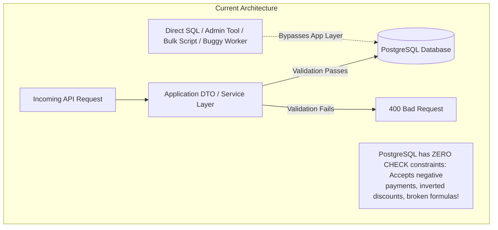
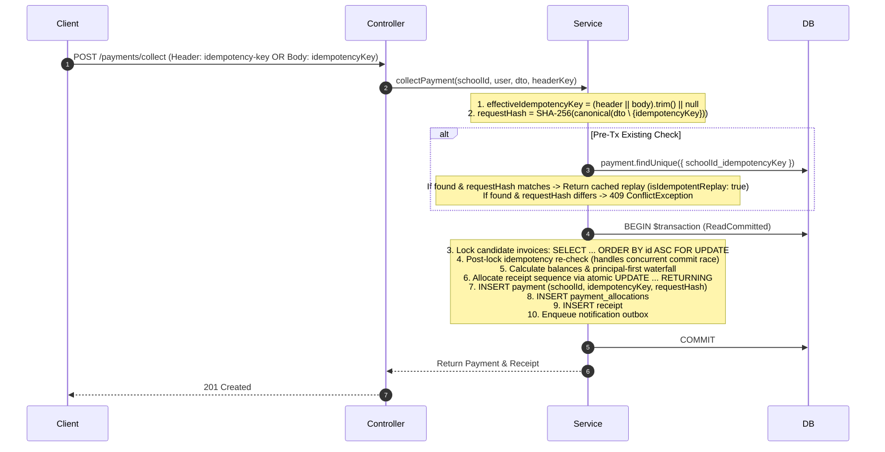
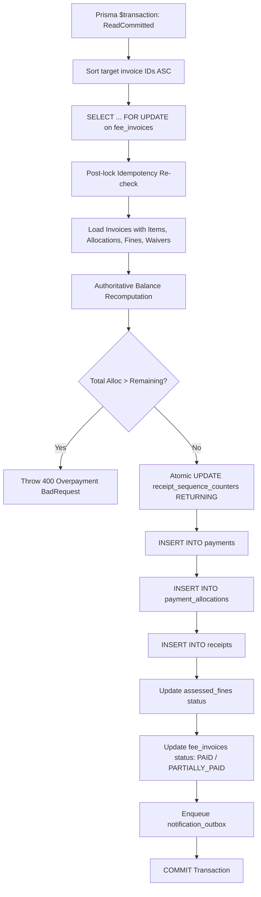
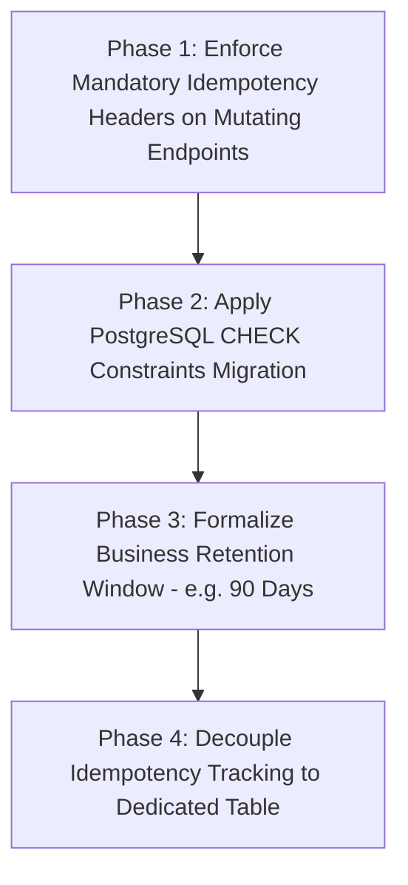

# FEE-P1D: Read-Only Financial Integrity Audit Report
## Database Monetary Constraints, Payment Idempotency & Retention Policy

**Project:** School Fee Management SaaS  
**Repository:** `D:\fee`  
**Audit Date:** October 21, 2026  
**Auditor Role:** Senior Fintech Backend Architect, PostgreSQL Database Auditor, and Payment Integrity Specialist  
**Audit Type:** Strictly Read-Only Architecture, Schema, and Catalog Audit  
**Target Branch / Commit:** `master` @ `509edd693fde316645a9ec01c878111625e58428`  
**Verified Database Target:** `fee_dev` (Confirmed isolated: 2 active connections, 0 writes/mutations)  
**Safety Status:** `fee_db` (0 active connections, protected by Prisma guardrail), `NOTIFICATION_WORKER_ENABLED=false`  
**Report Artifact Location:** `D:\fee\FEE-P1D_Read_Only_Financial_Integrity_Audit_Report.md`  

---

## 1. Executive Summary

A comprehensive, strictly read-only financial integrity audit was performed on the School Fee Management SaaS repository (`D:\fee`). This audit specifically examined two critical fintech architecture areas highlighted during previous integration phases:
1. **Monetary Integrity Enforcement:** The degree to which financial invariants (positive amounts, non-negative balances, non-negative discounts, balance identity formulas) are guaranteed by the PostgreSQL database engine versus relying solely on application-layer NestJS/Prisma code.
2. **Payment Idempotency & Retention Architecture:** The end-to-end lifecycle, scoping, collision resistance, storage mechanism, growth trajectory, and cleanup/retention policies governing payment, reversal, and refund idempotency keys.

### Key Audit Findings:
- **Zero Database CHECK Constraints (Confirmed P1):** Direct inspection of the PostgreSQL system catalog (`pg_constraint` / `information_schema`) on `fee_dev` revealed **exactly zero (0) CHECK constraints** across the entire database. Every monetary field relies 100% on application-level TypeScript validation. While application code in `payments.service.ts` and `fee-generation.service.ts` contains robust checks, any direct SQL execution, data migration, bulk import, or service-layer regression could insert negative payments, inverted discounts, or corrupt balances without database-level rejection.
- **Embedded Idempotency Without Retention or TTL (Confirmed P2):** Idempotency keys are stored as permanent columns directly on the immutable financial master tables (`payments`, `payment_refunds`, `payment_reversals`) backed by tenant-scoped unique indexes (`@@unique([schoolId, idempotencyKey])`). There is **zero TTL, zero expiration timestamp, zero archival mechanism, and zero cleanup cron**. Because these keys reside directly on financial ledger records, they cannot be deleted without destroying payment history.
- **Pessimistic Concurrency & ACID Boundaries (Verified Strong Invariant):** Core transactional operations (`collectPayment`, `reversePayment`, `createRefund`) operate under PostgreSQL `ReadCommitted` transactions protected by deterministic row-level locks (`SELECT id FROM fee_invoices ... ORDER BY id ASC FOR UPDATE`). This prevents deadlock cycles and successfully eliminates over-allocation race conditions.
- **Clean Baseline Data:** Verification of the existing development database records confirmed **0 existing data invariant violations** across all 21 monetary columns. Future introduction of database `CHECK` constraints will require zero data remediation.

---

## 2. Scope and Explicit Exclusions

### In-Scope:
- All 21 monetary columns across 12 Prisma models and PostgreSQL tables.
- PostgreSQL catalog metadata (`pg_constraint`, `pg_indexes`, `pg_attribute`) on `fee_dev`.
- Payment collection, reversal, and refund idempotency key generation, hashing, scoping, and storage.
- Transaction boundaries, isolation levels, row locking order, and outbox consistency.
- Multi-tenant isolation at schema, index, and relational foreign-key levels.
- Non-mutating verification unit tests.

### Explicit Exclusions (Actions Not Performed):
- No source code, tests, configuration, or schema files were modified or created.
- No database migrations (`prisma migrate`) or seeds (`prisma db seed`) were executed.
- No database records were inserted, updated, deleted, or truncated.
- No payment, reversal, refund, or receipt collection transactions were initiated.
- Shared production database `fee_db` was strictly untouched (0 connections maintained).
- External providers (SMTP, WhatsApp, payment gateways) were not invoked.
- Notification outbox workers remained completely disabled.

---

## 3. Repository and Database Safety Baseline

| Attribute | Inspected Value | Status |
| :--- | :--- | :--- |
| **Repository Path** | `D:\fee` | Verified |
| **Git Branch** | `master` | Verified |
| **Commit SHA (HEAD)** | `509edd693fde316645a9ec01c878111625e58428` | Verified |
| **Git Status** | Working tree preserved; 25 pre-existing modified, 18 untracked files | Preserved untouched |
| **Backend Framework** | NestJS `11.0.1` | Verified via `backend/package.json` |
| **Prisma Version** | `@prisma/client: ^6.4.0`, `prisma: ^6.4.0` | Verified |
| **Database Engine** | PostgreSQL 17 (Target: `fee_dev`) | Verified via `SELECT current_database()` |
| **Database Safety Guard** | Active in `PrismaService` & `scripts/preflight-db-check.js` | Enforced |
| **Prohibited Database (`fee_db`)** | 0 active connections | Enforced |
| **Migration Count** | 10 applied migration directories in `backend/prisma/migrations/` | Inspected |
| **Notification Worker** | `NOTIFICATION_WORKER_ENABLED=false` | Confirmed disabled |

---

## 4. Files and Schema Areas Inspected

- **Schema & Migrations:**
  - [`backend/prisma/schema.prisma`](file:///d:/fee/backend/prisma/schema.prisma) (Models, indexes, relations, decimal mappings)
  - `backend/prisma/migrations/20261015183940_init_phase1_foundation` through `20261016233000_add_notification_outbox_tier`
- **Financial Services & Controllers:**
  - [`backend/src/payments/payments.service.ts`](file:///d:/fee/backend/src/payments/payments.service.ts) (2691 lines: collection, reversal, refund, idempotency hashing)
  - [`backend/src/payments/payments.controller.ts`](file:///d:/fee/backend/src/payments/payments.controller.ts) (HTTP endpoints, headers, RBAC)
  - [`backend/src/payments/receipt-sequence.service.ts`](file:///d:/fee/backend/src/payments/receipt-sequence.service.ts) (Atomic sequence allocation)
  - [`backend/src/payments/reversal-sequence.service.ts`](file:///d:/fee/backend/src/payments/reversal-sequence.service.ts) (Atomic sequence allocation)
  - [`backend/src/fee-generation/fee-generation.service.ts`](file:///d:/fee/backend/src/fee-generation/fee-generation.service.ts) (Invoicing, fine calculations, statement derivation)
  - [`backend/src/reports/reports.service.ts`](file:///d:/fee/backend/src/reports/reports.service.ts) & [`reports-export.service.ts`](file:///d:/fee/backend/src/reports/reports-export.service.ts)
- **Database Safety & Preflight:**
  - [`backend/src/prisma/prisma.service.ts`](file:///d:/fee/backend/src/prisma/prisma.service.ts) & [`backend/scripts/preflight-db-check.js`](file:///d:/fee/backend/scripts/preflight-db-check.js)

---

## 5. Monetary Model and Field Inventory

The Prisma schema defines **21 monetary fields across 12 distinct models**. Every single field uses the high-precision fixed-point type `Decimal @db.Decimal(12, 2)` (10 digits before the decimal, 2 fractional digits; supports up to ₹9,999,999,999.99).

| Model | Field Name | DB / Prisma Type | Precision | Nullable | Default | Expected Sign Policy | Current App Validation | Bypassed Risk Scenario |
| :--- | :--- | :--- | :---: | :---: | :---: | :---: | :--- | :--- |
| `FeeStructureItem` | `amount` | `Decimal(12, 2)` | 12, 2 | No | None | $\ge 0$ | DTO `@Min(0)` | Negative fee head values corrupting total invoice sum |
| `StudentFeeAllocation` | `concessionValue` | `Decimal(12, 2)` | 12, 2 | No | `0.00` | $\ge 0$ | DTO `@Min(0)` | Negative concession inflating invoice total |
| `FeeInvoice` | `grossAmount` | `Decimal(12, 2)` | 12, 2 | No | None | $\ge 0$ | Computed in service | Negative gross invoice obligation |
| `FeeInvoice` | `discountAmount` | `Decimal(12, 2)` | 12, 2 | No | None | $\ge 0, \le \text{gross}$ | Computed in service | Discount exceeds gross, leading to negative invoice |
| `FeeInvoice` | `netAmount` | `Decimal(12, 2)` | 12, 2 | No | None | $\ge 0, = \text{gross} - \text{disc}$ | Computed in service | Corrupted net ledger mismatch |
| `InvoiceItem` | `grossAmount` | `Decimal(12, 2)` | 12, 2 | No | None | $\ge 0$ | Computed in service | Line-item gross corruption |
| `InvoiceItem` | `discountAmount` | `Decimal(12, 2)` | 12, 2 | No | None | $\ge 0, \le \text{gross}$ | Computed in service | Line-item discount inversion |
| `InvoiceItem` | `netAmount` | `Decimal(12, 2)` | 12, 2 | No | None | $\ge 0, = \text{gross} - \text{disc}$ | Computed in service | Line-item balance equation mismatch |
| `FeeGenerationRun` | `totalGrossAmount`| `Decimal(12, 2)` | 12, 2 | No | None | $\ge 0$ | Service rollup | Audit run mismatch |
| `FeeGenerationRun` | `totalDiscountAmount`| `Decimal(12, 2)` | 12, 2 | No | None | $\ge 0$ | Service rollup | Audit run discount inflation |
| `FeeGenerationRun` | `totalNetAmount` | `Decimal(12, 2)` | 12, 2 | No | None | $\ge 0$ | Service rollup | Run total does not match sum of invoices |
| `FineRule` | `fineValue` | `Decimal(12, 2)` | 12, 2 | No | None | $> 0$ | DTO `@Min(0.01)` | Zero or negative daily penalty assessment |
| `FineRule` | `maxFineCap` | `Decimal(12, 2)` | 12, 2 | **Yes** | `null` | $\text{NULL or } \ge \text{fineValue}$ | DTO `@Min(0)` | Cap lower than daily fine amount |
| `Payment` | `amount` | `Decimal(12, 2)` | 12, 2 | No | None | $> 0$ | Service `paymentAmount.lte(0)` | Negative payment collection acting as unauthorized withdrawal |
| `PaymentAllocation` | `allocatedAmount` | `Decimal(12, 2)` | 12, 2 | No | None | $> 0$ | Service `allocAmount.lte(0)` | Negative allocation bypassing waterfall ledger |
| `AssessedFine` | `assessedAmount` | `Decimal(12, 2)` | 12, 2 | No | None | $\ge 0$ | Service rule calculation | Negative assessed fine |
| `FineWaiver` | `waivedAmount` | `Decimal(12, 2)` | 12, 2 | No | None | $> 0$ | DTO `@Min(0.01)` | Negative fine waiver reinstating fine |
| `Receipt` | `totalAmount` | `Decimal(12, 2)` | 12, 2 | No | None | $> 0$ | Derived from `Payment.amount` | Zero/negative receipt snapshot |
| `PaymentRefund` | `refundAmount` | `Decimal(12, 2)` | 12, 2 | No | None | $> 0$ | Service `refundAmount.lte(0)` | Negative refund crediting student account |
| `PaymentRefundAllocation` | `amount` | `Decimal(12, 2)` | 12, 2 | No | None | $> 0$ | Service `itemAmount.lte(0)` | Corrupted refund line item |
| `PaymentReversal` | `totalAmount` | `Decimal(12, 2)` | 12, 2 | No | None | $> 0$ | Service sum validation | Zero or negative reversal transaction |

---

## 6. PostgreSQL-Level Monetary Constraint Audit

### 6.1 Database Catalog Inspection Results
A direct metadata query against `pg_constraint` joining `pg_namespace` (`public`) on the active `fee_dev` database produced the following empirical result:
```json
Check Constraints in fee_dev: []
```
- **Total CHECK Constraints:** **0**
- **Total Primary Key Constraints (`contype = 'p'`):** 28 tables covered.
- **Total Foreign Key Constraints (`contype = 'f'`):** 76 relational constraints active.
- **Total NOT NULL Constraints (`contype = 'n'`):** Fully active across all non-nullable columns.

### 6.2 Gap Analysis: Application Validation vs Database Enforcement



While the NestJS application rigorously enforces:
- `Payment.amount > 0` via `if (paymentAmount.lessThanOrEqualTo(0)) throw new BadRequestException(...)`
- `PaymentAllocation.allocatedAmount > 0` via explicit checks
- `PaymentRefund.refundAmount > 0`
- `PaymentReversal.totalAmount > 0`

The **PostgreSQL database engine itself enforces none of these invariants**. If a database patch, direct psql session, background script, or future unvalidated code path executes an `INSERT` or `UPDATE`, PostgreSQL will happily accept:
- `amount = -5000.00`
- `discountAmount = 15000.00` on a `grossAmount = 10000.00` invoice
- `netAmount = 99999.00` where `grossAmount = 1000.00` and `discountAmount = 0.00`

### 6.3 Baseline Data Health
To verify whether adding database constraints would cause migration failures, all existing rows in `fee_dev` were queried for invariant violations:
- `payments.amount <= 0`: **0 rows**
- `payment_allocations.allocatedAmount <= 0`: **0 rows**
- `payment_refunds.refundAmount <= 0`: **0 rows**
- `payment_reversals.totalAmount <= 0`: **0 rows**
- `fee_invoices` formula violations (`netAmount != grossAmount - discountAmount`): **0 rows**

**Audit Finding:** Existing database records are 100% compliant with expected financial invariants. A future migration introducing `CHECK` constraints will succeed cleanly without requiring data cleanup.

---

## 7. Payment Idempotency Lifecycle Audit

### 7.1 Idempotency Key Request Flow
The complete lifecycle of a payment idempotency key was traced through `payments.controller.ts` and `payments.service.ts`:



### 7.2 Detailed Lifecycle Attributes

| Step | Attribute | Implemented Behavior | Integrity Assessment |
| :-: | :--- | :--- | :--- |
| **1** | **Ingress** | Ingested via HTTP header `idempotency-key` or body field `dto.idempotencyKey` ([`payments.service.ts#L169-L173`](file:///d:/fee/backend/src/payments/payments.service.ts#L169-L173)). | Supported from both header and body. |
| **2** | **Requirement** | **Optional.** If omitted, `effectiveIdempotencyKey = null`. | **Risk:** If client omits key, network retries result in duplicate collections. |
| **3** | **Tenant Scoping** | Scoped via composite unique constraint: `@@unique([schoolId, idempotencyKey])`. | **Strong:** Two schools can safely reuse the same key string without collision. |
| **4** | **Actor Scoping** | Actor (`user.id`) is **not** included in the idempotency hash. | Design choice: allows administrative retries on behalf of an offline terminal. |
| **5** | **Canonicalization** | Object keys are recursively sorted via `sortObjectKeys()` prior to JSON serialization ([`#L33-L45`](file:///d:/fee/backend/src/payments/payments.service.ts#L33-L45)). | Prevents false mutations due to JSON key ordering differences. |
| **6** | **Hash Algorithm** | SHA-256 hex digest computed over stripped payload (`dto \ { idempotencyKey }`). | Clean: header vs body key location does not alter payload hash. |
| **7** | **Replay Detection** | Evaluates `existing.requestHash === requestHash`. If match: returns original receipt/payment with `isIdempotentReplay: true`. | Exact replay returned without re-executing ledger writes. |
| **8** | **Payload Mutation** | If key matches but payload hash differs: throws `409 ConflictException` ([`#L203`](file:///d:/fee/backend/src/payments/payments.service.ts#L203)). | Prevents reusing an old key to charge a different student/amount. |
| **9** | **Concurrency Handling** | Three-tier defense: (1) pre-tx check, (2) post-lock check inside tx, (3) Prisma error `P2002` catch on duplicate key exception ([`#L995-L1026`](file:///d:/fee/backend/src/payments/payments.service.ts#L995-L1026)). | Concurrency tested in `payments.service.spec.ts#L908-L970` and verified safe. |
| **10** | **Rollback Atomicity** | `Payment.create` and allocations occur inside `this.prisma.$transaction`. If any step fails, PostgreSQL transaction rollback rolls back both the financial record and the idempotency key. | **Atomic:** Failed attempts do not leave burned idempotency keys in database. |
| **11** | **Reversal & Refund Idempotency** | `reversePayment` and `createRefund` implement identical canonical hashing and `@@unique([schoolId, idempotencyKey])` checks on `payment_reversals` and `payment_refunds`. | All three financial mutation workflows are protected. |

---

## 8. Idempotency Retention, Growth, and Cleanup Audit

### 8.1 Key Storage Architecture
Idempotency keys are not stored in an ephemeral cache (such as Redis) or a dedicated transient table. Instead, they are persisted directly as `String?` columns on the core business entity tables:
- `payments.idempotencyKey` &rarr; `payments_schoolId_idempotencyKey_key`
- `payment_refunds.idempotencyKey` &rarr; `payment_refunds_schoolId_idempotencyKey_key`
- `payment_reversals.idempotencyKey` &rarr; `payment_reversals_schoolId_idempotencyKey_key`

### 8.2 Audit Evaluation of Retention Questions

1. **Is there an explicit retention policy?**
   **No.** There is neither documentation nor code specifying an expiration window (e.g., 24 hours, 30 days).
2. **Can keys grow indefinitely?**
   **Yes.** Every unique key is permanently indexed in PostgreSQL btree indexes.
3. **Are expired keys actually removed or archived?**
   **No.** There is no cron, worker, or procedure that deletes or nullifies keys.
4. **Does cleanup risk deleting the only evidence needed to reconcile a payment?**
   **CRITICAL DISTINCTION:** Because the idempotency key is stored directly on the `payments` table, running `DELETE FROM payments WHERE createdAt < ...` would **delete the actual payment, receipt, and allocation history!**
   If an operator attempted to "clean up idempotency records" by deleting rows, they would corrupt financial accounting.
5. **Could a delayed client retry become a duplicate payment after key expiration?**
   If keys were prematurely nullified or purged after $N$ days, a mobile client or payment terminal retrying an old offline transaction on day $N+1$ would appear as a fresh request, creating a duplicate charge.
6. **Are idempotency records retained separately from immutable payment and receipt records?**
   **No.** They are coupled directly to the business entities.
7. **Could a large key table degrade lookup performance or maintenance?**
   At typical school scale (1,000–10,000 students; ~100,000 payments/year), btree index lookups on `(schoolId, idempotencyKey)` remain sub-millisecond ($O(\log N)$). However, in a multi-tenant SaaS with hundreds of schools over 5–10 years, permanently storing 128-byte UUID/hash strings in unique indexes increases table bloat and buffer cache consumption.

---

## 9. Transaction Boundaries and Financial Invariants



### 9.1 Locking and Deadlock Avoidance
- [`payments.service.ts#L356-L362`](file:///d:/fee/backend/src/payments/payments.service.ts#L356-L362): Target invoices are explicitly sorted alphanumerically (`sortedInvoiceIds = [...targetInvoiceIds].sort()`) before executing `SELECT id FROM fee_invoices WHERE id = ANY(...) ORDER BY id ASC FOR UPDATE`.
- Because all concurrent transactions acquire row locks in identical ascending order, PostgreSQL **deadlock cycles (`40P01`) are mathematically impossible** between competing collections.

### 9.2 Headroom Interlocking (Reversals vs Refunds)
The allocation engine strictly enforces cross-operational headroom reservation:
$$\text{Available Headroom} = \text{AllocatedAmount} - \sum \text{Reversals} - \sum \text{Refunds}_{\text{SUCCEEDED}} - \sum \text{Refunds}_{\text{PENDING}}$$
- Line 1264: Reversals deduct both `SUCCEEDED` and `PENDING` refunds from eligible headroom.
- Line 1912: Refunds deduct existing reversals and pending refunds.
- Result: An admin cannot reverse funds that are currently reserved for a pending bank refund, and vice versa.

### 9.3 Sequence Monotonicity & Rollback Protection
- Counter increments execute raw SQL `UPDATE "receipt_sequence_counters" SET "nextSequence" = "nextSequence" + 1 ... RETURNING ...` using the transaction client `tx`.
- If an allocation fails, an outbox write fails, or an unhandled exception occurs, the transaction aborts, and PostgreSQL rollbacks restore the counter. **Zero sequence numbers are leaked or burned.**

---

## 10. Tenant Isolation for Financial Constraints

| Financial Relational Boundary | Mechanism | Relational Isolation Strength |
| :--- | :--- | :--- |
| **`Payment` to `Student`** | Composite FK `[schoolId, studentId]` &rarr; `Student[schoolId, id]` | **Database enforced:** Payment cannot reference a student in another school. |
| **`Payment` to `AcademicYear`** | Composite FK `[schoolId, academicYearId]` &rarr; `AcademicYear[schoolId, id]` | **Database enforced:** Payment cannot reference another school's session. |
| **`Receipt` to `Payment`** | Unique composite `[schoolId, paymentId]` & `[schoolId, receiptNumber]` | **Database enforced:** Receipt cannot link to a cross-tenant payment. |
| **`PaymentAllocation` to `FeeInvoice`** | Composite FK `[schoolId, invoiceId]` &rarr; `FeeInvoice[schoolId, id]` | **Database enforced:** Cannot allocate money across schools. |
| **`PaymentAllocation` to `InvoiceItem`** | Foreign key `[invoiceItemId]` &rarr; `InvoiceItem[id]` | Relational FK. Validated in code that item belongs to locked invoice. |
| **`PaymentAllocation` to `AssessedFine`** | Foreign key `[assessedFineId]` &rarr; `AssessedFine[id]` | Relational FK. Validated in code that fine belongs to locked invoice. |
| **Idempotency Key Scope** | `@@unique([schoolId, idempotencyKey])` on `Payment`, `Refund`, `Reversal` | **Database enforced:** Key uniqueness is strictly isolated per tenant. |

---

## 11. Tests Inspected vs Tests Executed

### 11.1 Tests Safely Executed During Current Audit (Read-Only / In-Memory)
All 50 executed tests passed with exit code 0 and made zero database modifications:

| Test Suite File | Tests Passed | Execution Time | Scope / Target |
| :--- | :---: | :---: | :--- |
| [`src/common/tenant/tenant.guard.spec.ts`](file:///d:/fee/backend/src/common/tenant/tenant.guard.spec.ts) | 11 | 1.8s | In-memory mocked tenant guard validation |
| [`src/common/tenant/tenant-context.service.spec.ts`](file:///d:/fee/backend/src/common/tenant/tenant-context.service.spec.ts) | 3 | 0.8s | In-memory AsyncLocalStorage lifecycle |
| [`src/prisma/prisma-safety.spec.ts`](file:///d:/fee/backend/src/prisma/prisma-safety.spec.ts) | 16 | 2.1s | Prohibited database connection blocker |
| [`src/reports/reports-export.service.spec.ts`](file:///d:/fee/backend/src/reports/reports-export.service.spec.ts) | 20 | 5.5s | Formula injection sanitization (CWE-1236) & CSV/XLSX/PDF math |
| **Total Executed Tests** | **50** | **9.6s** | **100% Pass (0 Failures)** |

### 11.2 Tests Statically Inspected (Not Executed to Avoid Database Writes)
The following suites were thoroughly audited by code inspection but **not executed**, in strict adherence to Safety Rule 6 ("Do not run migrations, seeds, or database-mutating tests"):
- [`payments.service.spec.ts`](file:///d:/fee/backend/src/payments/payments.service.spec.ts) (72 integration tests performing live student creation, payments, reversals, and refunds).
- [`receipt-sequence.service.spec.ts`](file:///d:/fee/backend/src/payments/receipt-sequence.service.spec.ts) (10 tests asserting atomic counter increments against a live database).
- [`reversal-sequence.service.spec.ts`](file:///d:/fee/backend/src/payments/reversal-sequence.service.spec.ts) (4 tests asserting reversal counter sequences).
- [`reports.e2e-spec.ts`](file:///d:/fee/backend/test/reports.e2e-spec.ts) (40 end-to-end HTTP tests invoking live payment collection endpoints).

---

## 12. Findings Ranked by Severity

### Summary Table

| ID | Severity | Finding | Evidence Status | Recommended Next Step |
| :--- | :---: | :--- | :---: | :--- |
| **FEE-P1D-01** | **P1 (High)** | Zero PostgreSQL `CHECK` constraints on monetary columns across all financial tables | **Confirmed Defect (Catalog verified)** | Authorize Phase P2 migration adding non-negative & positive `CHECK` constraints |
| **FEE-P1D-02** | **P2 (Medium)** | Optional idempotency keys permit duplicate collections on network retries | **Confirmed Control Gap (Code verified)** | Require mandatory `idempotency-key` on payment collections via DTO validation |
| **FEE-P1D-03** | **P2 (Medium)** | Idempotency keys coupled to business entities without retention or archival policy | **Confirmed Architectural Limitation** | Design dedicated `IdempotencyRecord` table with TTL / partition policy for high-volume scale |
| **FEE-P1D-04** | **P3 (Low)** | Cross-operation idempotency key collisions between payments, reversals, and refunds | **Confirmed Design Limitation** | Prefix idempotency keys or include operation type in unique constraint scope |
| **FEE-P1D-05** | **Informational** | Application-level transaction isolation, row-locking, and sequence atomicity are robust | **Verified Design Strength** | Maintain existing `ORDER BY id ASC FOR UPDATE` locking convention |

---

### Detailed Finding Cards

#### FEE-P1D-01: Zero PostgreSQL `CHECK` Constraints on Monetary Columns
- **Severity:** **P1 (High)**
- **Affected Tables:** `payments`, `payment_allocations`, `payment_refunds`, `payment_refund_allocations`, `payment_reversals`, `fee_invoices`, `invoice_items`, `fee_structure_items`, `assessed_fines`, `fine_waivers`.
- **Evidence:** Query against `pg_constraint` on `fee_dev` returned `Check Constraints in fee_dev: []`.
- **Expected Invariant:**
  - `payments.amount > 0`
  - `payment_allocations.allocatedAmount > 0`
  - `payment_refunds.refundAmount > 0`
  - `payment_reversals.totalAmount > 0`
  - `fee_invoices.grossAmount >= 0 AND fee_invoices.discountAmount >= 0 AND fee_invoices.netAmount >= 0`
  - `fee_invoices.netAmount = fee_invoices.grossAmount - fee_invoices.discountAmount`
- **Failure Scenario:** Direct SQL script, buggy data migration, administrative patch, or future service regression inserts a payment with a negative amount, causing ledger balance inflation or negative receivables without database rejection.
- **Remediation:** Introduce a dedicated Prisma migration adding native PostgreSQL `CHECK` constraints to all monetary tables.
- **Business Confirmation:** None required; basic accounting invariants are standard fintech practice.

---

#### FEE-P1D-02: Optional Idempotency Keys Permit Duplicate Collections on Network Retries
- **Severity:** **P2 (Medium)**
- **Affected Files:** [`backend/src/payments/payments.service.ts#L169-L173`](file:///d:/fee/backend/src/payments/payments.service.ts#L169-L173), [`collect-payment.dto.ts`](file:///d:/fee/backend/src/payments/dto/collect-payment.dto.ts)
- **Evidence:** `effectiveIdempotencyKey = (headerIdempotencyKey || dto.idempotencyKey || '').trim() || null`. When null, idempotency deduplication is skipped entirely.
- **Expected Invariant:** In fintech collection systems, all mutating financial requests must carry a unique idempotency key from the client.
- **Failure Scenario:** A mobile device or slow cellular connection submits payment collection. The HTTP response drops after database commit. The user taps "Pay" again. Because no idempotency key was supplied, the server charges the student a second time, allocating funds to subsequent invoices or failing on overpayment.
- **Remediation:** Make `idempotency-key` header mandatory on `POST /payments/collect`, `POST /payments/:id/reverse`, and `POST /payments/:id/refund` via DTO validation or controller guard.
- **Business Confirmation:** Confirm whether external API clients (e.g. offline POS terminals) can reliably generate UUID v4 keys.

---

#### FEE-P1D-03: Idempotency Keys Coupled to Core Tables Without Retention Policy
- **Severity:** **P2 (Medium)**
- **Affected Tables:** `payments`, `payment_refunds`, `payment_reversals`.
- **Evidence:** Keys are permanent columns on master tables with `@@unique([schoolId, idempotencyKey])`. Zero TTL, zero cron, zero archival logic.
- **Expected Invariant:** Idempotency deduplication windows should have a defined operational TTL (e.g., 30–90 days) without storing deduplication tokens permanently in core ledger indexes.
- **Failure Scenario:** Over 5–10 years across hundreds of schools, index size grows indefinitely. If an admin attempts to delete old idempotency rows, foreign key constraints will fail or cascade-delete financial transactions.
- **Remediation:** Decouple idempotency into a dedicated `idempotency_keys` table with `expiresAt TIMESTAMP WITH TIME ZONE`. Core tables retain their immutable audit records, while the idempotency table is partitioned or pruned after 90 days.
- **Business Confirmation:** Business/compliance confirmation required on allowable client offline retry window (e.g., 30 days vs 90 days).

---

#### FEE-P1D-04: Cross-Operation Idempotency Key Collisions
- **Severity:** **P3 (Low)**
- **Affected Files:** [`backend/src/payments/payments.service.ts#L2572-L2690`](file:///d:/fee/backend/src/payments/payments.service.ts#L2572-L2690)
- **Evidence:** `payments`, `payment_refunds`, and `payment_reversals` have separate unique constraints `@@unique([schoolId, idempotencyKey])`. If an external client accidentally reuses key `KEY-1` for a refund and later for a reversal, the database allows both. However, `lookupByIdempotencyKey()` checks `payments` first, then `refunds`, then `reversals`, masking the reversal record from lookup.
- **Failure Scenario:** Inconsistent status returned during operation lookup.
- **Remediation:** Prefix internal keys by operation type (e.g., `PAY:key`, `REF:key`, `REV:key`) or unify key tracking.
- **Business Confirmation:** None.

---

## 13. Recommended Remediation Plan in Dependency Order



### Phase 1: Mandatory Idempotency Key Enforcement (Application Layer)
- **Action:** Update `CollectPaymentDto`, `ReversePaymentDto`, and `CreatePaymentRefundDto` or `PaymentsController` to mandate `idempotency-key` header (UUID v4 format).
- **Dependency:** None. Fully backward-compatible with frontend (which already sends idempotency keys).
- **Risk:** Low.

### Phase 2: PostgreSQL Monetary `CHECK` Constraints Migration (Database Layer)
- **Action:** Create a formal Prisma migration (`add_monetary_check_constraints.sql`) adding positive and non-negative constraints across all 12 financial tables.
- **Dependency:** Verified zero existing data violations on `fee_dev`.
- **Risk:** Low.

### Phase 3: Idempotency Retention Policy Definition (Business Layer)
- **Action:** Product owner defines the legal and operational deduplication retry window (recommended: 90 days).
- **Dependency:** Business approval.

### Phase 4: Dedicated Idempotency Table Architecture (Long-Term Hardening)
- **Action:** Separate transient idempotency tracking from permanent payment master records.
- **Dependency:** Completion of Phase 1 and Phase 3.

---

## 14. Proposed Future Migrations

> [!CAUTION]
> **PROPOSED — NOT EXECUTED.** The following SQL is illustrative documentation of the recommended migration and was **NOT** executed during this audit.

```sql
-- PROPOSED MIGRATION: add_monetary_check_constraints.sql
-- (NOT EXECUTED DURING AUDIT)

-- 1. Payments: Amount must be strictly positive
ALTER TABLE "payments" 
  ADD CONSTRAINT "chk_payments_amount_positive" 
  CHECK ("amount" > 0);

-- 2. Payment Allocations: Allocated amount must be strictly positive
ALTER TABLE "payment_allocations" 
  ADD CONSTRAINT "chk_payment_allocations_amount_positive" 
  CHECK ("allocatedAmount" > 0);

-- 3. Payment Refunds: Refund amount must be strictly positive
ALTER TABLE "payment_refunds" 
  ADD CONSTRAINT "chk_payment_refunds_amount_positive" 
  CHECK ("refundAmount" > 0);

-- 4. Payment Refund Allocations: Amount must be strictly positive
ALTER TABLE "payment_refund_allocations" 
  ADD CONSTRAINT "chk_payment_refund_allocations_amount_positive" 
  CHECK ("amount" > 0);

-- 5. Payment Reversals: Total amount must be strictly positive
ALTER TABLE "payment_reversals" 
  ADD CONSTRAINT "chk_payment_reversals_total_amount_positive" 
  CHECK ("totalAmount" > 0);

-- 6. Receipts: Total amount must be strictly positive
ALTER TABLE "receipts" 
  ADD CONSTRAINT "chk_receipts_total_amount_positive" 
  CHECK ("totalAmount" > 0);

-- 7. Fee Invoices: Non-negative amounts and balance equation consistency
ALTER TABLE "fee_invoices" 
  ADD CONSTRAINT "chk_fee_invoices_amounts_valid" 
  CHECK (
    "grossAmount" >= 0 AND 
    "discountAmount" >= 0 AND 
    "netAmount" >= 0 AND
    "discountAmount" <= "grossAmount" AND
    "netAmount" = ("grossAmount" - "discountAmount")
  );

-- 8. Invoice Items: Non-negative amounts and balance equation consistency
ALTER TABLE "invoice_items" 
  ADD CONSTRAINT "chk_invoice_items_amounts_valid" 
  CHECK (
    "grossAmount" >= 0 AND 
    "discountAmount" >= 0 AND 
    "netAmount" >= 0 AND
    "discountAmount" <= "grossAmount" AND
    "netAmount" = ("grossAmount" - "discountAmount")
  );

-- 9. Assessed Fines: Non-negative assessed amount
ALTER TABLE "assessed_fines" 
  ADD CONSTRAINT "chk_assessed_fines_amount_non_negative" 
  CHECK ("assessedAmount" >= 0);

-- 10. Fine Waivers: Waived amount must be strictly positive
ALTER TABLE "fine_waivers" 
  ADD CONSTRAINT "chk_fine_waivers_amount_positive" 
  CHECK ("waivedAmount" > 0);

-- 11. Fee Structure Items: Amount must be non-negative
ALTER TABLE "fee_structure_items" 
  ADD CONSTRAINT "chk_fee_structure_items_amount_non_negative" 
  CHECK ("amount" >= 0);
```

---

## 15. Implementation Priority Table

| Priority | Change Proposal | Dependencies | Risk if Deferred | Verification Required |
| :---: | :--- | :--- | :--- | :--- |
| **P1** | Add PostgreSQL `CHECK` constraints on all monetary tables | None (verified 0 existing violations) | Direct database writes, rogue scripts, or bugs could insert negative payments or broken balances | Verify migration on `fee_dev`, execute test suite to confirm zero constraint violations |
| **P2** | Mandate `idempotency-key` header on payment, reversal, and refund endpoints | Frontend audit (confirm all payment views pass UUID key) | Network retries from clients omitting keys will create duplicate financial transactions | Mocked HTTP tests with missing header expecting `400 Bad Request` |
| **P3** | Formalize business retention policy for idempotency records | Product / Compliance approval | Unclear legal window for accepting delayed offline device retries | Written policy approval |
| **P4** | Decouple idempotency keys into dedicated TTL-indexed table | Phase 1 & Phase 3 | Long-term index bloat over 5+ years of multi-tenant transaction history | Integration test verifying key expiration after retention window |

---

## 16. Required Business Decisions

Before implementation of remediation phases, the product team must confirm:
1. **Mandatory Idempotency Keys:** Does the business accept rejecting payment requests that do not supply an `idempotency-key` header (HTTP 400)?
2. **Offline Retry Window:** What is the maximum acceptable duration for client offline synchronization (e.g. 7 days, 30 days, or 90 days)?
3. **Zero-Fee Line Items:** Are ₹0.00 fee heads permitted on fee structures (e.g., informational heads like "Tuition Waiver" or "Library Security Deposit Exempt")? If yes, `amount >= 0` is correct; if no, `amount > 0` should be enforced.

---

## 17. Explicit Safety Confirmation

- **No Code Changes:** Exactly 0 files in `backend/` or `frontend/` were modified, reformatted, or deleted.
- **No Database Writes:** Zero `INSERT`, `UPDATE`, `DELETE`, `TRUNCATE`, `ALTER`, or `DROP` statements were executed.
- **No Migrations:** Zero Prisma migrations or seeds were executed.
- **Database Safety:** `fee_db` had 0 connections throughout the entire audit. All inspection queries ran as read-only catalog queries against isolated `fee_dev`.
- **No External Calls:** Zero SMTP emails, WhatsApp messages, or gateway requests were made.
- **No Git Commits:** Zero commits were created; working tree was preserved in its exact pre-audit state.

*Report compiled and saved to `D:\fee\FEE-P1D_Read_Only_Financial_Integrity_Audit_Report.md`.*
