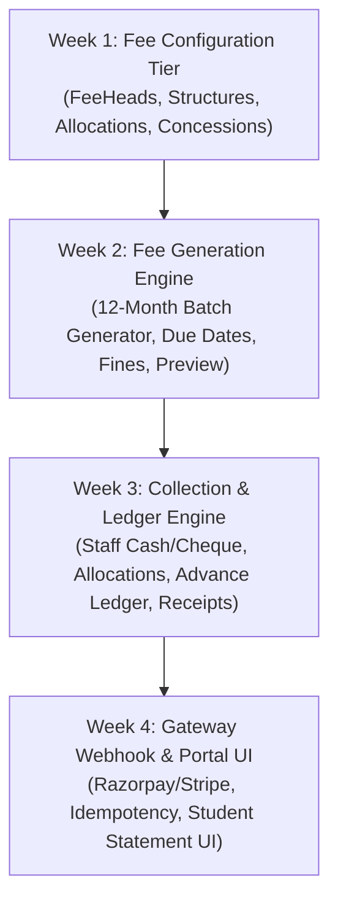

# School Fee Management System — Phase 2A: Fee Engine Design Freeze

**Repository**: `d:\fee`  
**Status**: DESIGN FROZEN — Awaiting Phase 2B Implementation Approval  
**Date**: October 16, 2026  
**Target**: 30-Day MVP (~2 hours/day incremental roadmap)  

---

## 1. Executive Summary & Core Financial Invariants

The Fee Engine is the mission-critical financial core of the School Fee Management System. To guarantee complete accounting integrity, zero duplicate billings, zero phantom collections, and zero cross-tenant leakage, this specification freezes the financial data model and business rules before any implementation begins.

### Core Financial Principles
1. **Obligation $\neq$ Payment**: A student's obligation to pay (Invoice) is an accounts receivable entry. A Payment is an accounts receivable settlement entry. They must never be modeled as the same entity.
2. **Gateway Attempt $\neq$ Confirmed Collection**: A payment gateway order or checkout session is an intent to pay. Money is only recognized when cryptographic signature verification or a signed webhook confirms settlement.
3. **Confirmed Collection Must Be Allocated**: A payment of \$10,000 received from a parent does not magically clear debt until it is explicitly mapped to specific invoice items (e.g., \$7,000 to Tuition, \$2,000 to Computer Lab, \$1,000 to Transport) via immutable `PaymentAllocation` records.
4. **Advance Is a Liability**: Unallocated excess payments (overpayments) are parked in the `AdvanceFeeLedger` as a credit balance liability, available for drawdown when future monthly invoices transition from `UPCOMING` to `DUE`.
5. **Refunds & Reversals Must Trace to Source**: A refund or bounced cheque reversal must reference the original `PaymentTransaction` and explicitly re-open the previously settled `InvoiceItem` balances.
6. **Waivers Must Be Authorized**: Fee concessions and discretionary discounts are not silent price drops; they are explicit `FeeAdjustment` entries with an authorized user ID, reason, and immutable audit trail.
7. **Sequential Receipts**: Every confirmed collection generates an immutable `FeeReceipt` with an atomic, gapless sequence number per school per academic year (e.g., `REC-2026-000142`) and a cryptographic SHA-256 seal.
8. **Monetary Precision Standard**: All monetary calculations and storage strictly use PostgreSQL `DECIMAL(12, 2)`. JavaScript IEEE-754 floating-point arithmetic is strictly prohibited; all server calculations use string-based decimal math (`decimal.js` or `Prisma.Decimal`).

---

## 2. Entity Mapping & MVP Model Architecture

To achieve a production-grade yet maintainable 30-day MVP, we choose the simplest coherent relational model while maintaining strict accounting separation:

| Model | Purpose | Design Decision / MVP Consolidation |
| :--- | :--- | :--- |
| **`FeeHead`** | Charge categories (Tuition, Transport, Lab, Exam) | Independent catalog per school. Flags: `isRecurring`, `isRefundable`, `isOptional`. |
| **`FeeStructure`** | Template tying a set of charges to a Class & Session | Scoped to `(schoolId, academicYearId, gradeId)`. |
| **`FeeStructureItem`** | Line items within a structure | Ties `FeeHead` with base amount and billing frequency (`MONTHLY`, `QUARTERLY`, `ANNUAL`, `ONE_TIME`). |
| **`FinePolicy`** | Grace periods and late fee calculation rules | Embedded directly into `FeeStructure` or referenced per structure to avoid separate policy bloat. |
| **`StudentFeeAllocation`** | Student-specific enrollment in a fee structure | Connects student to structure, records student-level concessions (`concessionType`, `concessionValue`), and transport stops. |
| **`FeeInvoice`** | Represents monthly or term fee obligation | Replaces flat `MonthlyFeeRecord`. Tracks status (`UPCOMING`, `DUE`, `OVERDUE`, `PARTIALLY_PAID`, `PAID`, `WAIVED`, `VOID`). |
| **`InvoiceItem`** | Itemized breakdown of an invoice | Tracks base amount, applied concession, fine addition, paid amount, and outstanding balance per `FeeHead`. |
| **`PaymentTransaction`** | Confirmed collection of funds | Unified transaction for Cash, Cheque, Bank Transfer, POS, and Online. Unique `idempotencyKey`. |
| **`PaymentAllocation`** | Apportionment of a payment to specific items | Explicit many-to-many bridge between `PaymentTransaction` and `InvoiceItem`. |
| **`AdvanceFeeLedger`** | Unallocated overpayment credits | Append-only credit ledger tracking unallocated funds and their automatic drawdown for future bills. |
| **`PaymentGatewayTransaction`** | Gateway checkout session / order | Tracks Razorpay/Stripe order lifecycle (`CREATED`, `ATTEMPTED`, `SUCCESS`, `FAILED`, `EXPIRED`). |
| **`WebhookEvent`** | Raw log of gateway webhooks | Guarantees signature verification and duplicate webhook replay defense (`eventId` unique). |
| **`FeeReceipt`** | Official tax/tuition receipt | 1-to-1 with `PaymentTransaction`. Atomic sequential numbering (`receiptNumber`). |
| **`FeeAdjustment`** | Authorized waivers and manual fine waivers | Explicit record of adjustments with required `authorizedByUserId` and reason. |
| **`RefundRecord`** | Cash or gateway refund tracking | Explicit link to `paymentTransactionId` and reversal allocations. |
| **`ImportJob`** | Batch Excel/CSV upload manager | Tracks status, total rows, processed rows, and failure logs for student/fee imports. |
| **`IdempotencyRecord`** | API request deduplication store | Prevents duplicate form submits or network retries on critical endpoints. |
| **`AuditLog`** | Immutable compliance log | Records actor, schoolId, entity, delta JSON, IP address, and timestamp. |

---

## 3. Complete Entity-Relationship (ER) Diagram

```mermaid
erDiagram
    School ||--o{ FeeHead : "defines"
    School ||--o{ FeeStructure : "configures"
    School ||--o{ StudentFeeAllocation : "allocates"
    School ||--o{ FeeInvoice : "bills"
    School ||--o{ PaymentTransaction : "collects"
    School ||--o{ AdvanceFeeLedger : "holds liability"
    School ||--o{ ImportJob : "executes"
    School ||--o{ AuditLog : "audits"

    FeeHead ||--o{ FeeStructureItem : "categorizes"
    FeeHead ||--o{ InvoiceItem : "specifies"

    FeeStructure ||--o{ FeeStructureItem : "contains"
    FeeStructure ||--o{ StudentFeeAllocation : "assigned to"

    GradeClass ||--o{ FeeStructure : "applies to"
    AcademicYear ||--o{ FeeStructure : "schedules"
    AcademicYear ||--o{ FeeInvoice : "cycles"

    Student ||--o{ StudentFeeAllocation : "enrolled in"
    Student ||--o{ FeeInvoice : "incurred by"
    Student ||--o{ PaymentTransaction : "paid for"
    Student ||--o{ AdvanceFeeLedger : "credited to"

    FeeInvoice ||--o{ InvoiceItem : "contains line items"
    FeeInvoice ||--o{ FeeAdjustment : "modified by"

    PaymentTransaction ||--o{ PaymentAllocation : "apportions"
    PaymentTransaction ||--o| FeeReceipt : "issues"
    PaymentTransaction ||--o| RefundRecord : "refunds"
    PaymentTransaction ||--o{ AdvanceFeeLedger : "generates credit"

    InvoiceItem ||--o{ PaymentAllocation : "settled by"
    InvoiceItem ||--o{ FeeAdjustment : "adjusted by"

    PaymentGatewayTransaction ||--o| PaymentTransaction : "confirms"
    WebhookEvent ||--o{ PaymentGatewayTransaction : "notifies"

    FeeHead {
        uuid id PK
        uuid schoolId FK
        string name
        string code UK
        boolean isRecurring
        boolean isOptional
        boolean isRefundable
        decimal defaultAmount
    }

    FeeStructure {
        uuid id PK
        uuid schoolId FK
        uuid academicYearId FK
        uuid gradeId FK
        string name
        int dueDayOfMonth
        int gracePeriodDays
        enum fineType "NONE | FLAT | DAILY_SLAB | PERCENTAGE"
        decimal fineAmount
        decimal maxFineCap
    }

    FeeStructureItem {
        uuid id PK
        uuid schoolId FK
        uuid feeStructureId FK
        uuid feeHeadId FK
        decimal amount
        enum frequency "MONTHLY | QUARTERLY | ANNUAL | ONE_TIME"
        int applicableMonth "1-12 or NULL for monthly"
    }

    StudentFeeAllocation {
        uuid id PK
        uuid schoolId FK
        uuid studentId FK
        uuid feeStructureId FK
        uuid academicYearId FK
        enum concessionType "NONE | PERCENTAGE | FLAT_DISCOUNT | FULL_SCHOLARSHIP"
        decimal concessionValue
        string concessionReason
        json customHeadOverrides
    }

    FeeInvoice {
        uuid id PK
        uuid schoolId FK
        uuid studentId FK
        uuid academicYearId FK
        string invoiceNumber UK
        int billingMonth "1 to 12"
        string billingMonthName "e.g. April 2026"
        date dueDate
        date graceDate
        decimal subtotalAmount
        decimal concessionAmount
        decimal fineAmount
        decimal totalAmount
        decimal paidAmount
        decimal balanceAmount
        enum status "UPCOMING | DUE | OVERDUE | PARTIALLY_PAID | PAID | WAIVED | VOID"
    }

    InvoiceItem {
        uuid id PK
        uuid schoolId FK
        uuid feeInvoiceId FK
        uuid feeHeadId FK
        decimal baseAmount
        decimal concessionAmount
        decimal fineAmount
        decimal netAmount
        decimal paidAmount
        decimal balanceAmount
        enum status "UNPAID | PARTIALLY_PAID | PAID | WAIVED"
    }

    PaymentTransaction {
        uuid id PK
        uuid schoolId FK
        uuid studentId FK
        string transactionNumber UK
        string idempotencyKey UK
        decimal amount
        enum paymentMethod "CASH | CHEQUE | BANK_TRANSFER | POS | ONLINE_GATEWAY"
        datetime paymentDate
        enum status "CONFIRMED | REVERSED | BOUNCED"
        string referenceNumber
        uuid recordedByUserId FK
    }

    PaymentAllocation {
        uuid id PK
        uuid schoolId FK
        uuid paymentTransactionId FK
        uuid feeInvoiceId FK
        uuid invoiceItemId FK
        decimal allocatedAmount
        datetime createdAt
    }

    FeeReceipt {
        uuid id PK
        uuid schoolId FK
        uuid paymentTransactionId FK
        string receiptNumber UK
        datetime issuedAt
        decimal totalAmount
        string receiptHash
    }

    AdvanceFeeLedger {
        uuid id PK
        uuid schoolId FK
        uuid studentId FK
        uuid sourcePaymentId FK
        decimal creditAmount
        decimal consumedAmount
        decimal balanceAmount
        enum status "AVAILABLE | DEPLETED | REFUNDED"
    }
```



---

## 4. Proposed Complete Prisma Schema Specification

Below is the verified, production-ready schema ready for Phase 2B migration:

```prisma
// =============================================================
// PHASE 2 ENUM SPECIFICATIONS
// =============================================================

enum FeeFrequency {
  MONTHLY
  QUARTERLY
  ANNUAL
  ONE_TIME
}

enum FineType {
  NONE
  FLAT
  DAILY_SLAB
  PERCENTAGE
}

enum ConcessionType {
  NONE
  PERCENTAGE
  FLAT_DISCOUNT
  FULL_SCHOLARSHIP
}

enum InvoiceStatus {
  UPCOMING
  DUE
  OVERDUE
  PARTIALLY_PAID
  PAID
  WAIVED
  VOID
}

enum InvoiceItemStatus {
  UNPAID
  PARTIALLY_PAID
  PAID
  WAIVED
}

enum PaymentMethod {
  CASH
  CHEQUE
  BANK_TRANSFER
  POS
  ONLINE_GATEWAY
}

enum PaymentStatus {
  CONFIRMED
  REVERSED
  BOUNCED
}

enum GatewayOrderStatus {
  CREATED
  ATTEMPTED
  SUCCESS
  FAILED
  EXPIRED
}

enum WebhookStatus {
  PENDING
  PROCESSED
  FAILED
  DUPLICATE
}

enum AdvanceStatus {
  AVAILABLE
  DEPLETED
  REFUNDED
}

enum AdjustmentType {
  DISCRETIONARY_DISCOUNT
  LATE_FINE_WAIVER
  CORRECTION_DEBIT
  CORRECTION_CREDIT
}

enum ImportJobType {
  STUDENT_ROSTER
  FEE_STRUCTURE
  HISTORICAL_LEDGER
}

enum ImportStatus {
  UPLOADED
  VALIDATING
  FAILED_VALIDATION
  PROCESSING
  COMPLETED
  FAILED
}

// =============================================================
// 1. FEE CONFIGURATION & STRUCTURE TIER
// =============================================================

model FeeHead {
  id              String             @id @default(uuid())
  schoolId        String
  name            String             // e.g. "Tuition Fee", "Lab Charges", "Transport Zone 1"
  code            String             // e.g. "TUIT", "LAB", "TRN_Z1"
  description     String?
  isRecurring     Boolean            @default(true)  // true = monthly/quarterly; false = annual/admission
  isOptional      Boolean            @default(false) // true for opt-in items like Transport, Meals
  isRefundable    Boolean            @default(false)
  defaultAmount   Decimal            @default(0.00) @db.Decimal(12, 2)
  createdAt       DateTime           @default(now())
  updatedAt       DateTime           @updatedAt

  school          School             @relation(fields: [schoolId], references: [id], onDelete: Cascade)
  structureItems  FeeStructureItem[]
  invoiceItems    InvoiceItem[]

  @@unique([schoolId, code])
  @@unique([schoolId, id])
  @@index([schoolId])
  @@map("fee_heads")
}

model FeeStructure {
  id              String                 @id @default(uuid())
  schoolId        String
  academicYearId  String
  gradeId         String
  name            String                 // e.g. "Grade 10 Standard Fee 2026-2027"
  description     String?

  // Embedded Fine Policy & Schedule Defaults
  dueDayOfMonth   Int                    @default(10)    // Invoices due on the 10th of every month
  gracePeriodDays Int                    @default(5)     // 5 days grace after due date before fine applies
  fineType        FineType               @default(FLAT)
  fineAmount      Decimal                @default(0.00) @db.Decimal(12, 2) // Flat fine or daily slab amount
  maxFineCap      Decimal                @default(500.00) @db.Decimal(12, 2) // Safety ceiling on fines

  createdAt       DateTime               @default(now())
  updatedAt       DateTime               @updatedAt

  school          School                 @relation(fields: [schoolId], references: [id], onDelete: Cascade)
  grade           GradeClass             @relation(fields: [schoolId, gradeId], references: [schoolId, id], onDelete: Cascade)
  academicYear    AcademicYear           @relation(fields: [schoolId, academicYearId], references: [schoolId, id], onDelete: Cascade)
  items           FeeStructureItem[]
  allocations     StudentFeeAllocation[]

  @@unique([schoolId, academicYearId, gradeId, name])
  @@unique([schoolId, id])
  @@index([schoolId])
  @@index([gradeId])
  @@index([academicYearId])
  @@map("fee_structures")
}

model FeeStructureItem {
  id              String        @id @default(uuid())
  schoolId        String
  feeStructureId  String
  feeHeadId       String
  amount          Decimal       @db.Decimal(12, 2)
  frequency       FeeFrequency  @default(MONTHLY)
  applicableMonth Int?          // 1 (April) to 12 (March), strictly for ONE_TIME or ANNUAL items
  createdAt       DateTime      @default(now())
  updatedAt       DateTime      @updatedAt

  school          School        @relation(fields: [schoolId], references: [id], onDelete: Cascade)
  feeStructure    FeeStructure  @relation(fields: [schoolId, feeStructureId], references: [schoolId, id], onDelete: Cascade)
  feeHead         FeeHead       @relation(fields: [schoolId, feeHeadId], references: [schoolId, id], onDelete: Cascade)

  @@unique([schoolId, feeStructureId, feeHeadId, frequency, applicableMonth])
  @@unique([schoolId, id])
  @@index([schoolId])
  @@index([feeStructureId])
  @@index([feeHeadId])
  @@map("fee_structure_items")
}

// =============================================================
// 2. STUDENT ALLOCATION & CONCESSION TIER
// =============================================================

model StudentFeeAllocation {
  id                  String         @id @default(uuid())
  schoolId            String
  studentId           String
  feeStructureId      String
  academicYearId      String

  // Concession / Scholarship Profile
  concessionType      ConcessionType @default(NONE)
  concessionValue     Decimal        @default(0.00) @db.Decimal(12, 2) // Percentage (e.g. 20.00) or Flat (e.g. 5000.00)
  concessionReason    String?        // e.g. "Sibling Discount", "Staff Child Concession"

  // Custom optional head inclusions (e.g. JSON array of opt-in FeeHead IDs like Transport)
  optedOptionalHeads  Json           @default("[]")
  customOverrides     Json           @default("{}") // Head-specific flat overrides

  createdAt           DateTime       @default(now())
  updatedAt           DateTime       @updatedAt

  school              School         @relation(fields: [schoolId], references: [id], onDelete: Cascade)
  student             Student        @relation(fields: [schoolId, studentId], references: [schoolId, id], onDelete: Cascade)
  feeStructure        FeeStructure   @relation(fields: [schoolId, feeStructureId], references: [schoolId, id], onDelete: Cascade)
  academicYear        AcademicYear   @relation(fields: [schoolId, academicYearId], references: [schoolId, id], onDelete: Cascade)

  @@unique([schoolId, studentId, academicYearId])
  @@unique([schoolId, id])
  @@index([schoolId])
  @@index([studentId])
  @@index([feeStructureId])
  @@map("student_fee_allocations")
}

// =============================================================
// 3. FEE OBLIGATION (INVOICE) TIER
// =============================================================

model FeeInvoice {
  id                  String             @id @default(uuid())
  schoolId            String
  studentId           String
  academicYearId      String
  invoiceNumber       String             // e.g. "INV-2026-000492"
  billingMonth        Int                // 1 (April) through 12 (March)
  billingMonthName    String             // e.g. "April 2026"
  dueDate             DateTime
  graceDate           DateTime

  // Financial Balances (PostgreSQL DECIMAL(12, 2))
  subtotalAmount      Decimal            @default(0.00) @db.Decimal(12, 2)
  concessionAmount    Decimal            @default(0.00) @db.Decimal(12, 2)
  fineAmount          Decimal            @default(0.00) @db.Decimal(12, 2)
  totalAmount         Decimal            @default(0.00) @db.Decimal(12, 2) // (subtotal - concession + fine)
  paidAmount          Decimal            @default(0.00) @db.Decimal(12, 2)
  balanceAmount       Decimal            @default(0.00) @db.Decimal(12, 2) // (totalAmount - paidAmount)

  status              InvoiceStatus      @default(UPCOMING)
  createdAt           DateTime           @default(now())
  updatedAt           DateTime           @updatedAt

  school              School             @relation(fields: [schoolId], references: [id], onDelete: Cascade)
  student             Student            @relation(fields: [schoolId, studentId], references: [schoolId, id], onDelete: Cascade)
  academicYear        AcademicYear       @relation(fields: [schoolId, academicYearId], references: [schoolId, id], onDelete: Cascade)
  items               InvoiceItem[]
  allocations         PaymentAllocation[]
  adjustments         FeeAdjustment[]

  @@unique([schoolId, studentId, academicYearId, billingMonth])
  @@unique([schoolId, invoiceNumber])
  @@unique([schoolId, id])
  @@index([schoolId])
  @@index([studentId])
  @@index([academicYearId])
  @@index([status])
  @@index([dueDate])
  @@map("fee_invoices")
}

model InvoiceItem {
  id                  String             @id @default(uuid())
  schoolId            String
  feeInvoiceId        String
  feeHeadId           String

  baseAmount          Decimal            @db.Decimal(12, 2)
  concessionAmount    Decimal            @default(0.00) @db.Decimal(12, 2)
  fineAmount          Decimal            @default(0.00) @db.Decimal(12, 2)
  netAmount           Decimal            @db.Decimal(12, 2) // (base - concession + fine)
  paidAmount          Decimal            @default(0.00) @db.Decimal(12, 2)
  balanceAmount       Decimal            @db.Decimal(12, 2) // (netAmount - paidAmount)

  status              InvoiceItemStatus  @default(UNPAID)
  createdAt           DateTime           @default(now())
  updatedAt           DateTime           @updatedAt

  school              School             @relation(fields: [schoolId], references: [id], onDelete: Cascade)
  feeInvoice          FeeInvoice         @relation(fields: [schoolId, feeInvoiceId], references: [schoolId, id], onDelete: Cascade)
  feeHead             FeeHead            @relation(fields: [schoolId, feeHeadId], references: [schoolId, id], onDelete: Cascade)
  allocations         PaymentAllocation[]
  adjustments         FeeAdjustment[]

  @@unique([schoolId, feeInvoiceId, feeHeadId])
  @@unique([schoolId, id])
  @@index([schoolId])
  @@index([feeInvoiceId])
  @@index([feeHeadId])
  @@map("invoice_items")
}

// =============================================================
// 4. PAYMENT COLLECTION & SETTLEMENT TIER
// =============================================================

model PaymentTransaction {
  id                  String                     @id @default(uuid())
  schoolId            String
  studentId           String
  transactionNumber   String                     // e.g. "TXN-2026-000812"
  idempotencyKey      String                     // Client UUID to prevent double charges
  amount              Decimal                    @db.Decimal(12, 2)
  paymentMethod       PaymentMethod              @default(CASH)
  paymentDate         DateTime                   @default(now())
  status              PaymentStatus              @default(CONFIRMED)

  // Payment Metadata
  referenceNumber     String?                    // Cheque No, Bank Ref, UTR, POS Auth code
  bankName            String?
  chequeDate          DateTime?
  notes               String?
  recordedByUserId    String?

  createdAt           DateTime                   @default(now())
  updatedAt           DateTime                   @updatedAt

  school              School                     @relation(fields: [schoolId], references: [id], onDelete: Cascade)
  student             Student                    @relation(fields: [schoolId, studentId], references: [schoolId, id], onDelete: Cascade)
  recordedBy          User?                      @relation(fields: [recordedByUserId], references: [id], onDelete: SetNull)
  allocations         PaymentAllocation[]
  receipt             FeeReceipt?
  refund              RefundRecord?
  advanceCredits      AdvanceFeeLedger[]
  gatewayTxn          PaymentGatewayTransaction?

  @@unique([schoolId, transactionNumber])
  @@unique([schoolId, idempotencyKey])
  @@unique([schoolId, id])
  @@index([schoolId])
  @@index([studentId])
  @@index([paymentDate])
  @@index([status])
  @@map("payment_transactions")
}

model PaymentAllocation {
  id                    String             @id @default(uuid())
  schoolId              String
  paymentTransactionId  String
  feeInvoiceId          String
  invoiceItemId         String
  allocatedAmount       Decimal            @db.Decimal(12, 2)
  createdAt             DateTime           @default(now())

  school                School             @relation(fields: [schoolId], references: [id], onDelete: Cascade)
  paymentTransaction    PaymentTransaction @relation(fields: [schoolId, paymentTransactionId], references: [schoolId, id], onDelete: Cascade)
  feeInvoice            FeeInvoice         @relation(fields: [schoolId, feeInvoiceId], references: [schoolId, id], onDelete: Cascade)
  invoiceItem           InvoiceItem        @relation(fields: [schoolId, invoiceItemId], references: [schoolId, id], onDelete: Cascade)

  @@unique([schoolId, paymentTransactionId, invoiceItemId])
  @@unique([schoolId, id])
  @@index([schoolId])
  @@index([paymentTransactionId])
  @@index([feeInvoiceId])
  @@index([invoiceItemId])
  @@map("payment_allocations")
}

model FeeReceipt {
  id                    String             @id @default(uuid())
  schoolId              String
  paymentTransactionId  String             @unique
  receiptNumber         String             // e.g. "REC/2026-27/000142"
  issuedAt              DateTime           @default(now())
  totalAmount           Decimal            @db.Decimal(12, 2)
  receiptHash           String             // Tamper-evident SHA-256 seal
  pdfStorageUrl         String?

  school                School             @relation(fields: [schoolId], references: [id], onDelete: Cascade)
  paymentTransaction    PaymentTransaction @relation(fields: [schoolId, paymentTransactionId], references: [schoolId, id], onDelete: Cascade)

  @@unique([schoolId, receiptNumber])
  @@unique([schoolId, id])
  @@index([schoolId])
  @@map("fee_receipts")
}

model AdvanceFeeLedger {
  id                    String             @id @default(uuid())
  schoolId              String
  studentId             String
  sourcePaymentId       String
  creditAmount          Decimal            @db.Decimal(12, 2)
  consumedAmount        Decimal            @default(0.00) @db.Decimal(12, 2)
  balanceAmount         Decimal            @db.Decimal(12, 2) // (creditAmount - consumedAmount)
  status                AdvanceStatus      @default(AVAILABLE)
  createdAt             DateTime           @default(now())
  updatedAt             DateTime           @updatedAt

  school                School             @relation(fields: [schoolId], references: [id], onDelete: Cascade)
  student               Student            @relation(fields: [schoolId, studentId], references: [schoolId, id], onDelete: Cascade)
  sourcePayment         PaymentTransaction @relation(fields: [schoolId, sourcePaymentId], references: [schoolId, id], onDelete: Cascade)

  @@unique([schoolId, id])
  @@index([schoolId])
  @@index([studentId])
  @@index([status])
  @@map("advance_fee_ledgers")
}

// =============================================================
// 5. GATEWAY & WEBHOOK TIER
// =============================================================

model PaymentGatewayTransaction {
  id                    String              @id @default(uuid())
  schoolId              String
  studentId             String
  orderId               String              // Razorpay order_id or Stripe intent_id
  gateway               String              // "RAZORPAY", "STRIPE", "PAYTM"
  amount                Decimal             @db.Decimal(12, 2)
  currency              String              @default("INR")
  status                GatewayOrderStatus  @default(CREATED)
  gatewayPaymentId      String?
  signature             String?
  rawPayload            Json?
  confirmedPaymentId    String?             @unique

  createdAt             DateTime            @default(now())
  updatedAt             DateTime            @updatedAt

  school                School              @relation(fields: [schoolId], references: [id], onDelete: Cascade)
  student               Student             @relation(fields: [schoolId, studentId], references: [schoolId, id], onDelete: Cascade)
  confirmedPayment      PaymentTransaction? @relation(fields: [confirmedPaymentId], references: [id], onDelete: SetNull)

  @@unique([schoolId, orderId])
  @@unique([schoolId, id])
  @@index([schoolId])
  @@index([status])
  @@map("payment_gateway_transactions")
}

model WebhookEvent {
  id                    String         @id @default(uuid())
  schoolId              String?        // May be null before payload parsed
  gateway               String         // "RAZORPAY", "STRIPE"
  eventId               String         // Gateway webhook event UUID
  eventType             String         // "payment.captured", "order.paid"
  payload               Json
  signatureVerified     Boolean        @default(false)
  status                WebhookStatus  @default(PENDING)
  errorMessage          String?
  processedAt           DateTime?
  createdAt             DateTime       @default(now())

  @@unique([gateway, eventId])
  @@index([status])
  @@index([createdAt])
  @@map("webhook_events")
}

// =============================================================
// 6. ADJUSTMENTS, REFUNDS & REVERSALS
// =============================================================

model FeeAdjustment {
  id                    String         @id @default(uuid())
  schoolId              String
  feeInvoiceId          String
  invoiceItemId         String?
  type                  AdjustmentType
  amount                Decimal        @db.Decimal(12, 2)
  reason                String
  authorizedByUserId    String
  createdAt             DateTime       @default(now())

  school                School         @relation(fields: [schoolId], references: [id], onDelete: Cascade)
  feeInvoice            FeeInvoice     @relation(fields: [schoolId, feeInvoiceId], references: [schoolId, id], onDelete: Cascade)
  invoiceItem           InvoiceItem?   @relation(fields: [invoiceItemId], references: [id], onDelete: SetNull)
  authorizedBy          User           @relation(fields: [authorizedByUserId], references: [id], onDelete: Restrict)

  @@unique([schoolId, id])
  @@index([schoolId])
  @@index([feeInvoiceId])
  @@map("fee_adjustments")
}

model RefundRecord {
  id                    String             @id @default(uuid())
  schoolId              String
  paymentTransactionId  String             @unique
  amount                Decimal            @db.Decimal(12, 2)
  reason                String
  authorizedByUserId    String
  refundMethod          PaymentMethod      @default(BANK_TRANSFER)
  referenceNumber       String?
  refundDate            DateTime           @default(now())
  createdAt             DateTime           @default(now())

  school                School             @relation(fields: [schoolId], references: [id], onDelete: Cascade)
  paymentTransaction    PaymentTransaction @relation(fields: [schoolId, paymentTransactionId], references: [schoolId, id], onDelete: Cascade)
  authorizedBy          User               @relation(fields: [authorizedByUserId], references: [id], onDelete: Restrict)

  @@unique([schoolId, id])
  @@index([schoolId])
  @@map("refund_records")
}

// =============================================================
// 7. OPERATIONS, IMPORTS & SYSTEM AUDITING
// =============================================================

model ImportJob {
  id                    String         @id @default(uuid())
  schoolId              String
  type                  ImportJobType
  fileName              String
  fileHash              String         // SHA-256 hash to prevent duplicate file uploads
  totalRows             Int            @default(0)
  processedRows         Int            @default(0)
  errorRows             Int            @default(0)
  status                ImportStatus   @default(UPLOADED)
  errorSummary          Json           @default("[]")
  uploadedByUserId      String
  createdAt             DateTime       @default(now())
  updatedAt             DateTime       @updatedAt

  school                School         @relation(fields: [schoolId], references: [id], onDelete: Cascade)
  uploadedBy            User           @relation(fields: [uploadedByUserId], references: [id], onDelete: Restrict)

  @@unique([schoolId, id])
  @@index([schoolId])
  @@index([status])
  @@map("import_jobs")
}

model IdempotencyRecord {
  id                    String         @id @default(uuid())
  schoolId              String
  key                   String         // Client-provided Idempotency-Key header
  endpoint              String         // API path (e.g. /api/v1/payments/collect)
  requestHash           String         // SHA-256 hash of payload
  responseStatus        Int
  responseBody          Json
  expiresAt             DateTime
  createdAt             DateTime       @default(now())

  @@unique([schoolId, key, endpoint])
  @@index([expiresAt])
  @@map("idempotency_records")
}

model AuditLog {
  id                    String         @id @default(uuid())
  schoolId              String?
  actorId               String
  actorEmail            String
  action                String         // "INVOICE_GENERATE", "PAYMENT_COLLECT", "WAIVER_APPROVE"
  entityType            String         // "FeeInvoice", "PaymentTransaction", "StudentFeeAllocation"
  entityId              String
  beforeState           Json?
  afterState            Json?
  ipAddress             String?
  userAgent             String?
  timestamp             DateTime       @default(now())

  school                School?        @relation(fields: [schoolId], references: [id], onDelete: SetNull)

  @@index([schoolId])
  @@index([entityType, entityId])
  @@index([timestamp])
  @@map("audit_logs")
}
```

---

## 5. Finalized Fee-Generation Business Rules

### 1. Academic Session Cycle (April to March)
- Standard Indian school session spans **12 billing cycles**:
  - `billingMonth = 1`: April
  - `billingMonth = 2`: May
  - ...
  - `billingMonth = 12`: March
- Each invoice has an explicit `dueDate` (e.g., the 10th of that month) and `graceDate` (e.g., 15th).

### 2. Recurring vs. Annual / One-Time Charges
- **`MONTHLY` items** (e.g. Tuition Fee, Transport Fee): Generated across all 12 monthly invoices.
- **`ANNUAL` items** (e.g. Annual Charges, Exam Charges, Library Fund): Generated **strictly in Month 1 (April)**, or the student's admission month if admitted mid-session. They **never** appear in subsequent monthly invoices.
- **`ONE_TIME` items** (e.g. Admission Fee, Registration Fee): Generated once upon student admission and never regenerated.
- **`isOptional` items** (e.g. Transport, Meal Plan): Only included if the student's `StudentFeeAllocation` explicitly opts into that `FeeHead`.

### 3. Upfront Batch Generation & "Upcoming" Months
- **Design Decision**: Upfront generation of the entire 12-month schedule for enrolled students at the start of the academic year.
- **State Progression**:
  - Future billing months where `dueDate > today` are marked **`UPCOMING`**.
  - Current billing month where `today >= dueDate - notificationWindow` transitions to **`DUE`**.
  - If unpaid past `graceDate`, status automatically transitions to **`OVERDUE`**.
  - Parents can view upcoming months on the portal and choose to pay them early.

### 4. Idempotency & Re-run Reconciliation Mechanics
- The unique constraint `@@unique([schoolId, studentId, academicYearId, billingMonth])` guarantees that executing a billing run twice can **never create duplicate invoices**.
- If a school administrator changes fee structures mid-year:
  - Invoices in `PAID` or `PARTIALLY_PAID` status are **strictly locked** and never altered.
  - Invoices in `UPCOMING` status can be updated via a safe reconciliation job (`POST /api/v1/fee-generation/reconcile`).
- **Dry-Run Preview**: `POST /api/v1/fee-generation/preview` returns the exact count of students, count of invoices, and breakdown of amounts before writing a single record to the database.

### 5. Late Fine Calculation & Capping
- If `today > graceDate` and invoice has an unpaid balance:
  - `FLAT`: Fixed late fine added once (e.g., ₹200).
  - `DAILY_SLAB`: Fine accrues daily: $\text{fine} = \min(\text{daysOverdue} \times \text{finePerDay}, \text{maxFineCap})$.
  - Fines are capped by `maxFineCap` to prevent runaway debt.
  - Fines can be waived by authorized school staff via `FeeAdjustment` with type `LATE_FINE_WAIVER`.

---

## 6. Finalized Payment, Allocation & Ledger Rules

### 1. Payment Scenarios Supported
- **Full Payment**: Extinguishes entire outstanding balance of selected invoices.
- **Partial Payment**: Reduces outstanding balance; invoice status updates to `PARTIALLY_PAID`.
- **Paying Selected Months**: Parent/Cashier selects specific months (e.g., April + May). Payment allocations strictly target items on those invoices.
- **Paying Outstanding Balance (FIFO)**: System allocates funds starting from the oldest overdue invoice items to newest.
- **Multi-Obligation Settlement**: A single ₹15,000 cash payment can simultaneously clear May Tuition, June Tuition, and an overdue fine on April.

### 2. Excess Payment & Advance Credit Ledger
- If payment received exceeds the total balance of selected/due invoices:
  - Due obligations are settled to 0 balance.
  - The remaining amount is automatically posted as a credit entry in `AdvanceFeeLedger` (`status: AVAILABLE`).
  - When the next month's invoice transitions to `DUE`, the system automatically draws down the advance credit, creates a `PaymentAllocation` referencing the original transaction, and updates the invoice balance.

### 3. Payment Allocation Sequence
When a payment is apportioned against an invoice:
1. **Late Fines** are settled first.
2. **Tuition Fee** is settled second.
3. **Other Recurring Fees** (Lab, Activity) are settled third.
4. **Optional Fees** (Transport) are settled fourth.

### 4. Online Payment Lifecycle & Webhook Idempotency
1. Client calls `POST /api/v1/payments/online/create-order` with selected invoice IDs.
2. Server validates invoice balances, calculates total amount, and creates a gateway order with Razorpay/Stripe.
3. `PaymentGatewayTransaction` created with status `CREATED`.
4. Client completes payment on gateway checkout.
5. Gateway sends webhook (`payment.captured` or `order.paid`).
6. Server verifies HMAC SHA-256 cryptographic signature:
   - Checks `WebhookEvent` table for `(gateway, eventId)`. If already present, marks `DUPLICATE` and returns HTTP 200 immediately.
   - If new, records `WebhookEvent` and proceeds to settlement.
7. Within a PostgreSQL transaction:
   - Updates `PaymentGatewayTransaction` to `SUCCESS`.
   - Creates confirmed `PaymentTransaction`.
   - Generates `PaymentAllocation` records.
   - Updates `FeeInvoice` and `InvoiceItem` balances and statuses.
   - Creates sequential `FeeReceipt`.

### 5. Concurrency Control & Double-Payment Prevention
- To prevent two cashiers from simultaneously recording payments against the same invoice, or a webhook firing while a cashier submits cash:
  - The payment service executes within `prisma.$transaction({ isolationLevel: Prisma.TransactionIsolationLevel.RepeatableRead })`.
  - Acquires a pessimistic row lock via PostgreSQL:
    ```sql
    SELECT id, "balanceAmount" FROM "fee_invoices" WHERE id IN (...) FOR UPDATE;
    ```
  - Re-verifies that `balanceAmount >= paymentAmount` inside the transaction. If balance was already settled by a concurrent thread, the second transaction is safely aborted.
  - Client supplies `Idempotency-Key` header; duplicates within 24 hours return the cached response without re-executing.

### 6. Refunds, Reversals & Bounced Cheques
- **Bounced Cheque / Payment Reversal**:
  - `PaymentTransaction` status changed to `REVERSED` or `BOUNCED`.
  - Reversed allocations re-open the original `InvoiceItem` balances.
  - `FeeAdjustment` with type `CORRECTION_DEBIT` records the dishonour penalty.
- **Refund**:
  - Requires `SCHOOL_ADMIN` approval.
  - Linked to original `PaymentTransaction`.
  - Creates negative ledger adjustment; original receipt remains on record with a cancellation/refund watermark.

---

## 7. Role-Based Access Control (RBAC) Matrix

| Action | `PLATFORM_SUPER_ADMIN` | `SCHOOL_ADMIN` | `FEE_STAFF` | `STUDENT` | `PARENT` |
| :--- | :---: | :---: | :---: | :---: | :---: |
| **Configure FeeHeads & Structures** | View Any School | Full (CRUD) | Read Only | No Access | No Access |
| **Set Concessions & Scholarships** | View Any School | Full (CRUD) | View Only | No Access | No Access |
| **Execute Session Fee Generation** | Dry Run Any School | Full (Execute) | Dry Run Only | No Access | No Access |
| **View Student Invoices & Statements** | Any School | Own School | Own School | Own Records | Linked Wards |
| **Record Cash / Cheque Collection** | No Access (Audit Only) | Own School | Own School | No Access | No Access |
| **Initiate Online Payment** | No Access | Own School | Own School | Own Invoices | Linked Wards |
| **Authorize Waivers & Adjustments** | Audit Log Only | Full (Authorize) | Request Only | No Access | No Access |
| **Process Refunds & Reversals** | Audit Log Only | Full (Authorize) | Request Only | No Access | No Access |
| **Download Official Receipts** | Any School | Own School | Own School | Own Receipts | Ward Receipts |
| **Batch Import Student Rosters/Fees** | Any School | Own School | Own School | No Access | No Access |
| **Access Financial Audit Trail** | Global Audit Log | School Audit Log | Daily Cashier Log | No Access | No Access |

---

## 8. Proposed REST API Contract

### A. Fee Configuration Endpoints

#### 1. Create Fee Head
`POST /api/v1/fee-heads`
```json
// Request
{
  "name": "Tuition Fee",
  "code": "TUIT",
  "isRecurring": true,
  "isOptional": false,
  "isRefundable": false,
  "defaultAmount": 3500.00
}

// Response: HTTP 201 Created
{
  "id": "e5b8d234-a123-4c56-b789-0123456789ab",
  "name": "Tuition Fee",
  "code": "TUIT",
  "isRecurring": true,
  "defaultAmount": "3500.00",
  "createdAt": "2026-10-16T00:30:00.000Z"
}
```

#### 2. Create Fee Structure with Schedule & Fine Policy
`POST /api/v1/fee-structures`
```json
// Request
{
  "academicYearId": "2026-2027-session-uuid",
  "gradeId": "grade-10-uuid",
  "name": "Grade 10 General Fee Structure 2026-2027",
  "dueDayOfMonth": 10,
  "gracePeriodDays": 5,
  "fineType": "FLAT",
  "fineAmount": 200.00,
  "maxFineCap": 1000.00,
  "items": [
    { "feeHeadId": "tuition-head-uuid", "amount": 3500.00, "frequency": "MONTHLY" },
    { "feeHeadId": "computer-lab-uuid", "amount": 500.00, "frequency": "MONTHLY" },
    { "feeHeadId": "annual-dev-uuid", "amount": 6000.00, "frequency": "ANNUAL", "applicableMonth": 1 }
  ]
}

// Response: HTTP 201 Created
{
  "id": "struct-uuid-001",
  "name": "Grade 10 General Fee Structure 2026-2027",
  "dueDayOfMonth": 10,
  "gracePeriodDays": 5,
  "fineType": "FLAT",
  "fineAmount": "200.00",
  "itemsCount": 3
}
```

---

### B. Fee Generation Endpoints

#### 1. Dry-Run Generation Preview
`POST /api/v1/fee-generation/preview`
```json
// Request
{
  "academicYearId": "2026-2027-session-uuid",
  "gradeId": "grade-10-uuid"
}

// Response: HTTP 200 OK
{
  "academicYear": "2026-2027",
  "grade": "Grade 10",
  "eligibleStudentsCount": 35,
  "totalInvoicesToGenerate": 420,
  "summaryByMonth": [
    {
      "billingMonth": 1,
      "billingMonthName": "April 2026",
      "dueDate": "2026-04-10T00:00:00.000Z",
      "totalGrossObligation": "350000.00",
      "totalConcessions": "24000.00",
      "totalNetObligation": "326000.00"
    }
  ],
  "totalAnnualObligation": "1848000.00"
}
```

#### 2. Execute Batch Generation
`POST /api/v1/fee-generation/execute`
```json
// Request
{
  "academicYearId": "2026-2027-session-uuid",
  "gradeId": "grade-10-uuid"
}

// Response: HTTP 200 OK
{
  "status": "COMPLETED",
  "generatedInvoicesCount": 420,
  "generatedItemsCount": 1260,
  "skippedExistingCount": 0,
  "executionTimeMs": 240
}
```

---

### C. Student Statement & Payment Endpoints

#### 1. Get Student Fee Statement
`GET /api/v1/students/:studentId/fee-statement`
```json
// Response: HTTP 200 OK
{
  "student": {
    "id": "student-uuid",
    "name": "Aarav Sharma",
    "admissionNumber": "ADM-2026-001",
    "grade": "Grade 10",
    "section": "A"
  },
  "summary": {
    "totalBilled": "48000.00",
    "totalPaid": "8000.00",
    "totalOutstandingDue": "3500.00",
    "totalUpcoming": "36500.00",
    "advanceCreditBalance": "0.00"
  },
  "invoices": [
    {
      "id": "inv-001",
      "billingMonthName": "April 2026",
      "dueDate": "2026-04-10",
      "status": "PAID",
      "totalAmount": "8000.00",
      "paidAmount": "8000.00",
      "balanceAmount": "0.00"
    },
    {
      "id": "inv-002",
      "billingMonthName": "May 2026",
      "dueDate": "2026-05-10",
      "status": "OVERDUE",
      "subtotalAmount": "4000.00",
      "fineAmount": "200.00",
      "totalAmount": "4200.00",
      "paidAmount": "700.00",
      "balanceAmount": "3500.00"
    },
    {
      "id": "inv-003",
      "billingMonthName": "June 2026",
      "dueDate": "2026-06-10",
      "status": "UPCOMING",
      "totalAmount": "4000.00",
      "paidAmount": "0.00",
      "balanceAmount": "4000.00"
    }
  ]
}
```

#### 2. Record Staff Collection (Cash / Cheque / Bank Transfer)
`POST /api/v1/payments/collect`
`Header: Idempotency-Key: 550e8400-e29b-41d4-a716-446655440000`
```json
// Request
{
  "studentId": "student-uuid",
  "amount": 3500.00,
  "paymentMethod": "CASH",
  "paymentDate": "2026-10-16T10:00:00.000Z",
  "notes": "Counter collection for May fee",
  "targetInvoices": [
    { "invoiceId": "inv-002", "amount": 3500.00 }
  ]
}

// Response: HTTP 201 Created
{
  "transactionNumber": "TXN-2026-000812",
  "receiptNumber": "REC/2026-27/000142",
  "amountPaid": "3500.00",
  "allocatedToInvoices": "3500.00",
  "creditedToAdvance": "0.00",
  "remainingStudentOutstanding": "0.00",
  "receiptUrl": "/api/v1/receipts/REC-2026-27-000142/download"
}
```

#### 3. Online Gateway Order Initiation
`POST /api/v1/payments/online/create-order`
```json
// Request
{
  "studentId": "student-uuid",
  "invoiceIds": ["inv-002", "inv-003"]
}

// Response: HTTP 200 OK
{
  "orderId": "order_Hkg12891dK",
  "amount": 7500.00,
  "currency": "INR",
  "gateway": "RAZORPAY",
  "keyId": "rzp_test_placeholder"
}
```

---

## 9. Financial Invariants & Database Constraints

1. **Composite Tenant Isolation**: Every financial table has a leading `schoolId` column and composite unique/foreign keys referencing `(schoolId, parentId)`.
2. **Payment Idempotency**: `@@unique([schoolId, idempotencyKey])` on `payment_transactions` prevents double charging.
3. **Receipt Uniqueness**: `@@unique([schoolId, receiptNumber])` guarantees zero receipt numbering collisions within a school.
4. **Invoice Generation Uniqueness**: `@@unique([schoolId, studentId, academicYearId, billingMonth])` prevents duplicate billing rows.
5. **Allocation Conservation Law**: For any `PaymentTransaction`:
   $$\sum \text{allocatedAmount} + \text{advanceCreditAmount} = \text{PaymentTransaction.amount}$$
   Enforced inside PostgreSQL atomic transaction.
6. **Invoice Balance Conservation Law**: For any `FeeInvoice`:
   $$\text{balanceAmount} = \text{totalAmount} - \text{paidAmount}$$
   Status must be `PAID` if and only if $\text{balanceAmount} = 0.00$.

---

## 10. Migration & Backward-Compatibility Risks & Mitigations

| Risk | Impact | Mitigation Strategy |
| :--- | :--- | :--- |
| **Existing Phase 1 Migration Drift** | Deploying Phase 2 migrations fails if Phase 1 history is out of sync. | Phase 1 baseline migration has been tested and verified via `npx prisma migrate deploy` on a fresh PostgreSQL database. Phase 2 migrations will be additive only (`prisma migrate dev --name add_fee_engine_models`). |
| **Existing Student Relationships** | Adding `StudentFeeAllocation` requires existing students to have a fee structure. | `StudentFeeAllocation` is designed with nullable defaults or populated via a data migration script linking existing students to default Grade 10 structure. |
| **Decimal Precision Drift** | Float conversions causing 1-cent discrepancy in totals. | Strict usage of Prisma `Decimal` type across all services, DTOs, and controllers. No JavaScript native `Number` math on monetary values. |
| **Concurrent Payment Race Condition** | Two requests paying the same invoice simultaneously causing negative balance. | Pessimistic locking via PostgreSQL `SELECT ... FOR UPDATE` on `fee_invoices` within `RepeatableRead` transaction isolation. |

---

## 11. Prioritized 30-Day MVP Implementation Plan (~2h / day)



- **Days 1–5 (Phase 2B)**: Fee Configuration Module
  - Schema migration for `FeeHead`, `FeeStructure`, `FeeStructureItem`, `StudentFeeAllocation`.
  - CRUD REST API for heads and structures with validation.
  - Student allocation and concession assignment service.
  - Multi-tenant e2e test suite for configuration.
- **Days 6–10 (Phase 2C)**: Batch Fee Generation Engine
  - Schema migration for `FeeInvoice`, `InvoiceItem`.
  - Dry-run preview service (`/api/v1/fee-generation/preview`).
  - Batch generation runner supporting recurring vs annual heads.
  - Fine policy processor (flat, daily slabs, grace periods).
  - Idempotency & reconciliation tests.
- **Days 11–17 (Phase 2D)**: Payment Collection, Allocation & Receipts
  - Schema migration for `PaymentTransaction`, `PaymentAllocation`, `FeeReceipt`, `AdvanceFeeLedger`.
  - Cash / Cheque / Bank Transfer collection service with transaction locking (`FOR UPDATE`).
  - Automatic payment allocation algorithm (FIFO / selected months / excess to advance).
  - Cryptographic receipt generator with sequential receipt numbers.
  - Concurrency & double-payment acceptance tests.
- **Days 18–24 (Phase 2E)**: Payment Gateway & Webhook Integration
  - Schema migration for `PaymentGatewayTransaction`, `WebhookEvent`.
  - Server-side order creation.
  - HMAC SHA-256 webhook verification & replay deduplication.
  - End-to-end webhook settlement simulation tests.
- **Days 25–30 (Phase 2F)**: Frontend Dashboard, Excel Imports & Hardening
  - React/Tailwind screens: Fee Configuration, Billing Run Preview, Cashier Counter, Student Statement, Payment History.
  - Excel/CSV bulk student & fee roster importer.
  - Final end-to-end security audit and production build.

---

## 12. Acceptance Test Specifications for Phase 2 Implementation

1. **Duplicate Billing Prevention Test**:
   - Run batch generation for Grade 10, Session 2026-2027.
   - Run batch generation a second time for the exact same grade and session.
   - Assert: Zero duplicate invoices created; invoice count remains exactly 12 per student.
2. **Partial Payment Allocation Test**:
   - Invoice has Tuition (\$3,000) and Lab (\$1,000) = \$4,000 total.
   - Record payment of \$2,500.
   - Assert: Tuition balance is \$500, Lab balance is \$1,000, Invoice status is `PARTIALLY_PAID`, Receipt issued for \$2,500.
3. **Overpayment & Advance Credit Test**:
   - Student has single due invoice of \$4,000.
   - Record payment of \$5,000.
   - Assert: Invoice balance is \$0.00 (`PAID`), \$1,000 credited to `AdvanceFeeLedger`.
   - Next month invoice of \$3,500 generated; draw down advance credit -> invoice balance becomes \$2,500.
4. **Cross-Tenant Financial Isolation Test**:
   - School A Cashier attempts to allocate a payment to an invoice belonging to School B.
   - Assert: Rejected with HTTP 403 / 404; database foreign key constraint prevents insertion.
5. **Concurrent Payment Race Condition Test**:
   - Two concurrent threads attempt to pay \$3,000 against a \$3,000 invoice at the exact same millisecond.
   - Assert: Thread 1 acquires row lock and settles the invoice; Thread 2 rejects or diverts to advance balance. Invoice balance never goes below zero.
