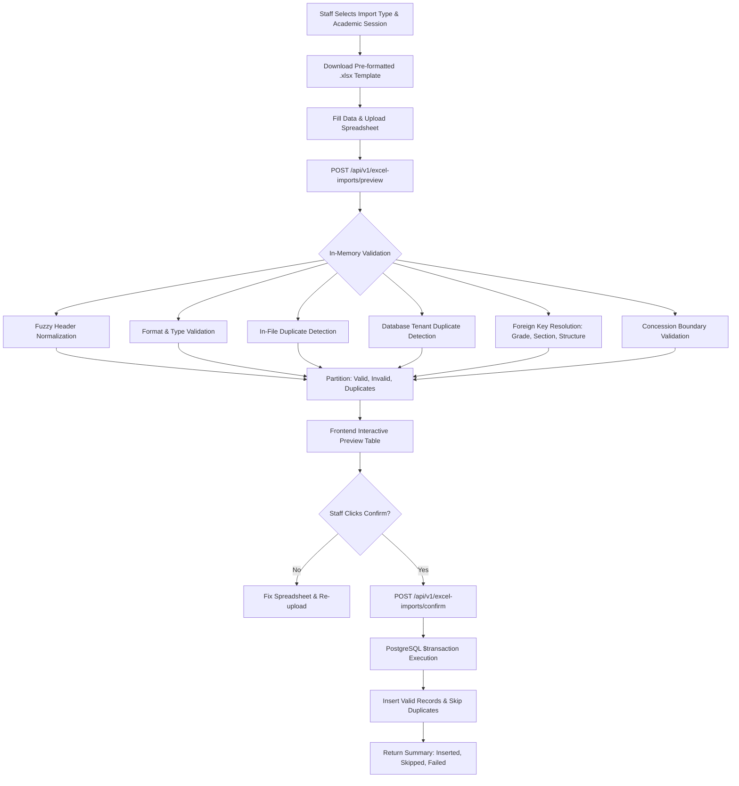

# Phase 2D-A: Student & Fee Data Excel Import Module — Implementation & Verification Report

**Project**: School Fee Management System  
**Repository**: `D:\fee`  
**Phase**: Phase 2D-A (Excel Import Module)  
**Baseline Remediation Commit**: `21bcc7a`  
**Status**: Complete, Verified & Tested  

---

## 1. Executive Summary

Phase 2D-A implements a production-grade, tenant-isolated Excel (`.xlsx`) data onboarding module for authorized school administrative staff (`PLATFORM_SUPER_ADMIN`, `SCHOOL_ADMIN`, `FEE_STAFF`). The system provides bulk data onboarding for:
1. **Student Master Records** (admission number, student name, grade/class, section, roll number, date of birth, guardian contact details, admission date).
2. **Student-to-Fee-Structure Allocations** (admission number, fee structure name, concession type, concession value, concession reason, start billing month).

The architecture adheres to strict financial invariants:
- **Zero Invoice Side-Effects**: Bulk importing students and allocations never generates or alters invoices or billing line items.
- **Strict Tenant Isolation**: `schoolId` is derived exclusively from authenticated server session context (`req.school.id`), never from spreadsheet rows.
- **Dry-Run Preview Before Commitment**: Uploaded spreadsheets are parsed and validated in-memory against database state without modifying any business records.
- **Idempotent Transactional Writes**: Explicit user confirmation executes inside an atomic PostgreSQL `$transaction` with safe handling of concurrent unique key collisions (`P2002`).

---

## 2. Technical Architecture & File Layout

### 2.1 Backend Implementation (`backend/src/excel-imports`)
- [`backend/src/excel-imports/dto/preview-import.dto.ts`](file:///D:/fee/backend/src/excel-imports/dto/preview-import.dto.ts): Defines `ImportType` (`STUDENT_MASTER`, `FEE_ALLOCATION`), validates `academicYearId` (UUID v4) and import type.
- [`backend/src/excel-imports/dto/confirm-import.dto.ts`](file:///D:/fee/backend/src/excel-imports/dto/confirm-import.dto.ts): Validates submission payload for confirmed import execution.
- [`backend/src/excel-imports/excel-imports.service.ts`](file:///D:/fee/backend/src/excel-imports/excel-imports.service.ts):
  - `generateTemplate`: Streams formatted ExcelJS workbook with header styling, column widths, and sample rows.
  - `previewImport`: Parses workbook buffer, applies fuzzy header normalization, performs in-file and database duplicate detection, validates referential keys (`gradeId`, `sectionId`, `feeStructureId`), validates concessions, and partitions rows into `validRows`, `invalidRows`, and `duplicateRows`.
  - `confirmImport`: Executes atomic batch insert inside `prisma.$transaction({ timeout: 30000 })`, safely skipping duplicates and returning detailed execution metrics.
- [`backend/src/excel-imports/excel-imports.controller.ts`](file:///D:/fee/backend/src/excel-imports/excel-imports.controller.ts):
  - `GET /api/v1/excel-imports/template?type=...`
  - `POST /api/v1/excel-imports/preview` (Multer file interceptor, 5MB file size limit, `.xlsx` MIME filter)
  - `POST /api/v1/excel-imports/confirm`
  - Guarded by `JwtAuthGuard`, `TenantGuard`, `RolesGuard` (`PLATFORM_SUPER_ADMIN`, `SCHOOL_ADMIN`, `FEE_STAFF`).
- [`backend/src/excel-imports/excel-imports.module.ts`](file:///D:/fee/backend/src/excel-imports/excel-imports.module.ts): Module registration imported into `AppModule`.

### 2.2 Frontend Implementation (`frontend/src`)
- [`frontend/src/services/api.ts`](file:///D:/fee/frontend/src/services/api.ts): Types (`ImportType`, `ImportPreviewResult`, `ImportConfirmResult`) and `excelImportsApi` client (`downloadTemplate`, `preview`, `confirm`).
- [`frontend/src/components/ExcelImportView.tsx`](file:///D:/fee/frontend/src/components/ExcelImportView.tsx):
  - Import type switcher (Student Master vs Fee Allocations).
  - Academic session selector populated from `metaApi.getAcademicYears()`.
  - Download Template trigger (automatic browser file download).
  - Drag-and-drop file upload zone with file size & format validation.
  - Interactive Preview Dashboard with summary metric cards (Total, Valid, Invalid, Duplicates).
  - Categorized tabs (All Rows, Valid, Invalid, Duplicates) with specific column error badges and duplicate reason indicators.
  - Explicit confirmation modal explaining insertion counts and skipped rows.
  - Post-import execution summary with inserted/skipped/failed breakdown.
- [`frontend/src/App.tsx`](file:///D:/fee/frontend/src/App.tsx): Integrated navigation tab "Excel Imports" and overview quick action.

---

## 3. Security & Multi-Tenant Enforcement

| Invariant | Implementation Mechanism | Verification Evidence |
| :--- | :--- | :--- |
| **Tenant Boundary** | `req.school.id` is derived from trusted JWT & `TenantGuard`. Spreadsheet rows cannot specify or override `schoolId`. | E2E Check 9: School B user cannot access or import School A data. |
| **Role Authorization** | `@Roles(PLATFORM_SUPER_ADMIN, SCHOOL_ADMIN, FEE_STAFF)` enforced at controller class level. | E2E Check 2: `STUDENT` and `PARENT` receive `403 Forbidden`. |
| **Cross-Tenant SuperAdmin** | `PLATFORM_SUPER_ADMIN` must supply `x-school-id` header to select target school. | E2E Check 2: Validated with `x-school-id: schoolAId`. |
| **Payload Restrictions** | Multer interceptor limits file size to 5MB and enforces `.xlsx` extension/MIME. | E2E Check 3: Text and CSV files rejected with `400 Bad Request`. |
| **Batch Size Cap** | Maximum 1,000 data rows permitted per file to prevent denial-of-service / memory exhaustion. | Service guard: `totalDataRows > 1000` triggers `400 Bad Request`. |

---

## 4. Import Workflow & Validation Rules



### 4.1 Student Master Import Validation
- **Required Fields**: `admissionNumber`, `firstName`, `lastName`, `gradeCode`, `section`.
- **Grade & Section Resolution**: Matched case-insensitively within active school tenant. Supports `'Section A'`, `'A'`, or `'Section B'`. If section does not belong to the resolved grade, row is flagged as `INVALID`.
- **Duplicate Checks**:
  - In-file duplicate admission numbers are flagged as `DUPLICATE` (first occurrence validated, subsequent occurrences marked redundant).
  - Admission numbers already existing in the school tenant database are flagged as `DUPLICATE`.
- **Date Parsing**: Supports ISO strings (`YYYY-MM-DD`) and common DD/MM/YYYY formats. Invalid dates flagged as `INVALID`.

### 4.2 Fee Allocation Import Validation
- **Required Fields**: `admissionNumber`, `feeStructureName`.
- **Student Lookup**: Admission number must exist as an active student in the active school tenant.
- **Structure Lookup**: Fee structure must exist, be `ACTIVE`, and belong to the selected academic session.
- **Grade Compatibility**: Grade of the student must exactly match the grade of the fee structure. Mismatches are rejected as `INVALID`.
- **Duplicate Allocation Check**: If student already has an active allocation for the specified academic session, the row is marked `DUPLICATE`.
- **Concession Boundaries**:
  - `PERCENTAGE` concession must be between 0% and 100%. Values > 100% are rejected as `INVALID`.
  - `FLAT_DISCOUNT` concession cannot exceed the total annual base fee of the assigned fee structure.
- **Billing Month**: `startBillingMonth` must be an integer between 1 (April) and 12 (March). Defaults to 1.

---

## 5. Automated Test Evidence

### 5.1 End-to-End Test Suite (`backend/test/excel-imports.e2e-spec.ts`)
Run command: `npm run test:e2e --workspace=backend -- test/excel-imports.e2e-spec.ts`

```text
PASS test/excel-imports.e2e-spec.ts (5.977 s)
  Phase 2D-A: Excel Import Module (e2e)
    1. Template Generation
      √ downloads student master template as .xlsx with sample rows (59 ms)
      √ downloads fee allocation template as .xlsx with sample rows (25 ms)
      √ rejects invalid import type with 400 Bad Request (7 ms)
    2. Role-Based Access Control (RBAC)
      √ rejects unauthenticated requests with 401 Unauthorized (9 ms)
      √ rejects STUDENT role with 403 Forbidden (19 ms)
      √ rejects PARENT role with 403 Forbidden (9 ms)
      √ allows FEE_STAFF and PLATFORM_SUPER_ADMIN access (26 ms)
    3. File Validation & Upload Filtering
      √ rejects requests without a file attachment with 400 Bad Request (15 ms)
      √ rejects non-.xlsx files (e.g. .txt or .csv) with 400 Bad Request (7 ms)
      √ rejects missing or invalid academic year session with 404 Not Found (14 ms)
      √ rejects spreadsheet with no data rows with 400 Bad Request (15 ms)
    4. Student Master Preview & Validation
      √ categorizes rows into valid, invalid, in-file duplicates, and db duplicates (57 ms)
    5. Student Master Confirmation & Execution
      √ atomically creates valid student records in active school tenant (51 ms)
      √ safely handles re-confirmation (idempotency) and skips existing records without crashing (10 ms)
    6. Fee Allocation Preview & Validation
      √ categorizes fee allocation rows (valid, invalid student, invalid structure, grade mismatch, duplicate) (30 ms)
    7. Fee Allocation Confirmation & Execution
      √ atomically creates student fee allocation in database with exact concession values (82 ms)
      √ detects existing allocation as duplicate in preview and skips on confirm (23 ms)
    8. Zero Invoice Side-Effects Guarantee
      √ verifies that importing students and allocations never generates invoices automatically (7 ms)
    9. Cross-Tenant Isolation Enforcement
      √ prevents School B user from importing or seeing School A data (22 ms)

Test Suites: 1 passed, 1 total
Tests:       19 passed, 19 total
Snapshots:   0 total
Time:        6.203 s
```

### 5.2 Full Monorepo Regression & Build Verification
1. **All Backend E2E Tests**:
   - `test/fee-generation.e2e-spec.ts`: PASS (38.156 s)
   - `test/fee-configuration.e2e-spec.ts`: PASS (11.052 s)
   - `test/excel-imports.e2e-spec.ts`: PASS (5.977 s)
   - `test/multi-tenant.e2e-spec.ts`: PASS
   - `test/health.e2e-spec.ts`: PASS
   - **Result**: 5 test suites passed, 94 tests passed, 0 failures.
2. **Backend Unit Tests**:
   - `npm run test --workspace=backend`: 2 suites passed, 6 tests passed.
3. **Frontend Unit Tests**:
   - `npm run test --workspace=frontend`: 1 suite passed, 9 tests passed.
4. **Full Monorepo Build**:
   - `npm run build`: Both `backend` (NestJS) and `frontend` (Vite + TypeScript) compiled with 0 errors.

---

## 6. Verification Checklist

- [x] ExcelJS integrated without third-party vulnerabilities (`npm audit`: 0 vulnerabilities).
- [x] Downloadable `.xlsx` templates with demonstration sample rows.
- [x] Multi-tenant scoping derived exclusively from server credentials.
- [x] In-memory dry-run validation preview without database writes.
- [x] In-file duplicate and database duplicate detection.
- [x] Frontend categorized table views (All / Valid / Invalid / Duplicates) with error badges.
- [x] Explicit user confirmation step with modal summary before writing records.
- [x] Atomic transactional batch insertion (`$transaction`).
- [x] Strict verification that zero invoices or billing items are created as a side-effect.
- [x] All automated regression tests passing across entire system.
